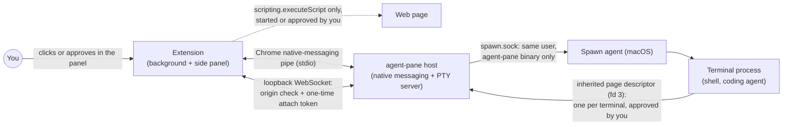

<p align="center">
  
</p>

<h1 align="center">Agent Pane</h1>
<p align="center">
  <a href="LICENSE"></a>
  <a href="https://go.dev/"></a>
  <a href="https://developer.chrome.com/docs/extensions/mv3/"></a>
</p>

<p align="center">
Claude Code, Codex and Pi in a real terminal, in Chrome's side panel.
</p>

For people who live in the TUI: each tab is a real local shell, not a chat box. An agent in that shell uses whatever browser tools it already has.

**Note:** this project is experimental. Agents run shell commands on your machine. Use with care.

## Why Agent Pane

The side panel is a terminal next to the browser, in the same window.

|                             | Agent Pane                                   | IDE / Terminal.app alone                   |
| --------------------------- | ------------------------------------------------ | ------------------------------------------ |
| Where the terminal sits     | Chrome side panel, beside the page               | A separate app                             |
| You stay in the loop        | Same window                                      | You switch away to watch a terminal        |
| One-click agents            | The agent commands your shell can already run    | Manual shells and PATH                     |

## Install

1. Add Agent Pane from the Chrome Web Store: <!-- TODO: replace with the Chrome Web Store listing link once it exists --> **[Chrome Web Store link: coming soon]**
2. Install the program the extension talks to:

   ```sh
   curl -fsSL https://raw.githubusercontent.com/asakin/agent-pane/main/install.sh | sh
   ```

3. Open the side panel from the Agent Pane extension icon

The script downloads the binary for this machine, puts `~/.local/bin` on `PATH`, and writes the native-messaging manifest Chrome needs. On macOS it also starts a LaunchAgent that launches the shell, so programs the agent runs are not children of Chrome. If that manifest is not written, the script exits with an error. Running it again writes the same files again.

## Updating

The Chrome Web Store updates the extension by itself. The program is updated by running the same command again:

```sh
curl -fsSL https://raw.githubusercontent.com/asakin/agent-pane/main/install.sh | sh
```

When the two are out of step, the side panel shows an update screen with that command instead of opening a terminal. Run it, then click **Retry**.

## How it works

It is a terminal in Chrome’s side panel: your shell, local files, `git`, language toolchains, existing CLI/agent tools, and whatever else is on your `PATH`. The extension does not attach to a browser and does not choose one. Browser automation is whatever CLI the agent runs.

## Usage

- **Tabs:** up to 8 terminals per Chrome window
- **One-Click Agent Launcher:** the side panel opens a shell. `+` runs the last agent you chose. The menu lists enabled agents that are on your `PATH`, then Terminal. Opening one moves it to the top unless Settings is set to keep the menu alphabetical
- **Settings:** shell, theme, font size, env, which agents are on, and the folder new agent tabs start in. The shell tab still starts in your home directory. Definitions live in `agents/` (see `agents/README.md`)

Terminal editing follows VS Code/Cursor conventions. Shift+Enter inserts a newline in
supporting agent CLIs; on macOS, Cmd+Enter does too. Cmd+Backspace deletes to the start
of the line, Cmd+Left/Right moves to its start/end, and Option+Left/Right moves by word.
Option+Backspace sends Ctrl+W (delete the previous whitespace-delimited word), and
Option+Delete deletes forward by word. On Windows/Linux, Ctrl+Backspace/Delete deletes
backward/forward by word. Option/Alt+Up/Down sends Ctrl+Up/Down.

On macOS, Cmd+A selects the terminal buffer, Cmd+K clears the visible terminal history,
and Escape clears a selection. Page Up/Down, Cmd+Home/End and Cmd+Option+Page Up/Down
scroll by page, to the top/bottom and by line respectively. Scrolling shortcuts apply
only to the normal buffer, leaving alternate-screen applications in control of page
navigation. Copy/paste uses the browser's normal shortcuts. Browser-reserved shortcuts
and Cursor's editor, pane, search and shell-integration commands are not remapped.

## Features

- **Session survival:** hide the side panel and open it again; the same tabs are still running
- **Page reading:** a terminal agent can read the browser tab next to it, after you approve (see below)

## Reading pages

"The tab" for a terminal is the Chrome tab locked to it in the status bar, or else the tab focused in its Chrome window when the read happens. Several terminals may read the same tab.

**The agent pulls.** Inside an Agent Pane terminal, these print to stdout. On failure they print the reason to stderr and exit non-zero.

| Command | Prints |
| --- | --- |
| `agent-pane page info` | URL and title, one per line |
| `agent-pane page selection` | The selected text, or nothing |
| `agent-pane page text` | The page's visible text (`document.body.innerText`) |
| `agent-pane page dom` | The full DOM as HTML |
| `agent-pane page markdown [--full]` | The page as Markdown: the main article (Readability), or the whole body with `--full` or when the article is thin (Turndown). Starts with `# <title>`, the URL and a blank line |

**Approvals.** The first read of a tab from a terminal shows a prompt in the side panel naming the terminal and the tab: **Allow this tab** (until the terminal closes), **Allow all tabs for this agent** (until it closes), or **Deny** (the command fails with `denied`). The command waits for your answer. Approvals live in memory for that terminal only and are never written to disk. Each read shows briefly in the panel with the tab it read.

**You push.** **Send tab** next to the status bar pastes the tab into the active terminal as Markdown; its menu picks info, selection, text or DOM instead. It uses bracketed paste and does not press Enter, so you can edit before sending. You start it, so it does not ask.

Chrome does not let extensions read `chrome://` pages, the Chrome Web Store, other extensions' pages or the built-in PDF viewer; reads of those fail and say why. Page text is written by whoever made the page: an agent should treat it as untrusted, never as instructions.

## Security

**What the extension can access, and why.** On Chrome it asks for `scripting` and access to all sites (`<all_urls>`). They are for [page reading](#reading-pages): a terminal agent can be given the focused tab, a selection, or a page you are logged in to. Both permissions are required at install, so Chrome asks once. The extension has no content scripts and no page listeners: page code runs only for a read you started or approved, in the tab's main frame and Chrome's isolated world, and returns what it read once. It also uses `nativeMessaging` to talk to the local `agent-pane` host, and `tabs`, `sidePanel` and `storage` for the panel itself.

**How the parts talk.**



| Channel | Who can reach it | Who cannot |
| --- | --- | --- |
| Web page and extension | The extension, through `executeScript` for a read you started or approved | Pages: there are no content scripts, no `externally_connectable`, and the background ignores messages that do not come from the extension's own pages |
| Extension and host | Chrome, which starts the host and owns its stdin/stdout | Pages and other processes: there is no listening port for this channel, and on Linux the host is not dumpable, so other processes cannot open its stdin/stdout through `/proc` |
| Side panel and host | The extension's own origin, holding an attach token it got over native messaging | Pages: the browser sets their `Origin` and the host refuses it. Local processes: they can send any `Origin` they like, so only the attach token stops them. A terminal id alone grants nothing |
| Host and spawn agent | The `agent-pane` binary running as you | Other users, and other programs that dial `spawn.sock` directly. This is not a boundary against code running as you: such code can start `agent-pane serve` itself and get a shell from the spawn agent that way |
| Terminal process and host | A process started inside a live Agent Pane terminal, which inherits that terminal's page descriptor, for a read you approved | Processes started anywhere else: there is no socket to dial, and the environment holds only a descriptor number. A descriptor from a closed terminal stops working, and approvals belong to one terminal |

**What it protects against.**

- **Web pages** cannot run commands, attach to a terminal, read terminal output, or reach the host. The background only answers the extension's own pages. The terminal WebSocket on `127.0.0.1` accepts only the extension's origin, and each connection needs a one-time attach token handed out over native messaging. A token works once, and stops working when a newer one is issued for the same terminal or when the native-messaging connection closes.
- **Other processes running as you** cannot read your pages through Agent Pane: page reads go only over the descriptor each terminal inherits, and need your approval. They also cannot attach to your existing terminals: a terminal id alone grants nothing, and only Chrome holds the attach tokens. On macOS they also cannot dial the spawn helper's socket directly: it checks the connecting process's user and executable (`proc_pidpath`) and accepts only `agent-pane` itself. That check does not stop them from running `agent-pane serve` themselves, which starts new terminals through the spawn agent with its macOS privacy grants; it only closes the shortcut.

**What it does not protect against.**

- A process running as your user that reads Chrome's profile, or debugs other processes (Chrome, the host, a shell), can see what they see. That includes taking a terminal's page descriptor out of its shell (through `/proc/<pid>/fd` on Linux, or a debugger); a read through it still needs your approval in the panel.
- A process running as your user that runs `agent-pane` itself gets what `agent-pane` can do, including a shell from the macOS spawn agent.
- A process running as your user that edits `~/.local/bin/agent-pane`, the host wrapper in `~/.local/share/agent-pane`, the native-messaging manifests, or the LaunchAgent plist (`~/Library/LaunchAgents/com.agentpane.spawn.plist`) controls what Chrome and launchd start.

Agent Pane cannot stop these; it only adds no new way in.

## Contributing

PRs welcome. For large changes, open an issue first. The extension runs page code only through `scripting.executeScript`, started by an extension action, and never adds `content_scripts` or `externally_connectable`. Page content goes to the host only over the native-messaging pipe, and to a terminal only over its inherited page descriptor. The full rules are in [AGENTS.md](AGENTS.md#security).

### Run a checkout

Build the binary and point the install script at it, then build the extension:

```sh
git clone https://github.com/asakin/agent-pane.git
cd agent-pane
go build -o agent-pane .
AGENT_PANE_BIN="$PWD/agent-pane" ./install.sh
cd extension && npm install && npm run build
```

A local build reports version `dev`, which passes the side panel's version check. Load the extension in Chrome:

1. Open `chrome://extensions`
2. Turn on **Developer mode**
3. Click **Load unpacked** and choose `extension/dist/chrome-mv3` from the checkout
4. Open the side panel from the Agent Pane extension icon

### Checks

Every pull request and every push to `main` runs [`.github/workflows/ci.yml`](.github/workflows/ci.yml) on Ubuntu. To run the same checks locally:

**extension** (Node 26):

```sh
cd extension
npm ci
npm run compile
npm test
npm run build
```

**go** (the Go version in `go.mod`):

```sh
gofmt -l .        # prints nothing when formatting is clean
go vet ./...
go test -race ./...
go build ./...
```

The extension job uploads `extension/dist/chrome-mv3` as the `extension-chrome-mv3` artifact, kept for 7 days. Download it from the workflow run's summary page, unzip it, and load the folder with **Load unpacked** in `chrome://extensions`.

## License

This project is licensed under the MIT License. See [LICENSE](LICENSE). Based on [Tweety](https://github.com/pomdtr/tweety) by Achille Lacoin.
