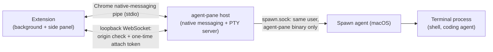

<p align="center">
  
</p>

<h1 align="center">Agent Pane</h1>
<p align="center">
  <a href="LICENSE"></a>
  <a href="https://go.dev/"></a>
  <a href="https://github.com/asakin/agent-pane/actions/workflows/ci.yml"></a>
  <a href="https://developer.chrome.com/docs/extensions/mv3/"></a>
</p>

<p align="center">
Claude Code, Codex and Pi in a real terminal, in Chrome's side panel.
</p>

For people who live in the TUI: each pane tab is a real local terminal. A coding agent in that terminal uses whatever browser tools it already has.

Agent Pane started from [Agent Terminal](https://github.com/rishiskhare/agent-terminal) and is now developed independently with a different focus. See [Origins and license](#origins-and-license) for attribution.

**Note:** this project is experimental. Agents run shell commands on your machine. Use with care.

## Why Agent Pane

The side panel is a terminal next to the browser, in the same window.

|                             | Agent Pane                                   | IDE / Terminal.app alone                   |
| --------------------------- | ------------------------------------------------ | ------------------------------------------ |
| Where the terminal sits     | Chrome side panel, beside the page               | A separate app                             |
| You stay in the loop        | Same window                                      | You switch away to watch a terminal        |
| One-click agents            | The agent commands your shell can already run    | Manual shells and PATH                     |

## Install

**For the current Agent Pane code, [run a checkout](#run-a-checkout).** The Chrome Web Store listing is not available yet. The preserved `v0.1.x` and `v0.2.0` releases are historical Agent Terminal builds, not releases of the current Agent Pane code. The release installation flow below will apply once an Agent Pane release is published.

1. Add Agent Pane from the Chrome Web Store: <!-- TODO: replace with the Chrome Web Store listing link once it exists --> **[Chrome Web Store link: coming soon]**
2. Install the program the extension talks to:

   ```sh
   curl -fsSL https://raw.githubusercontent.com/asakin/agent-pane/main/install.sh | sh
   ```

3. Open the side panel from the Agent Pane extension icon

The script downloads the binary for this machine, puts `~/.local/bin` on `PATH`, and writes the native-messaging manifest Chrome needs. On macOS it also starts a LaunchAgent that launches the shell independently of Chrome. If that manifest is not written, the script exits with an error. Running it again writes the same files again.

## Updating

The Chrome Web Store updates the extension by itself. The program is updated by running the same command again:

```sh
curl -fsSL https://raw.githubusercontent.com/asakin/agent-pane/main/install.sh | sh
```

When the two are out of step, the side panel shows an update screen with that command instead of opening a terminal. Run it, then click **Retry**.

## How it works

It is a terminal in Chrome’s side panel: your shell, local files, `git`, language toolchains, existing CLI/agent tools, and whatever else is on your `PATH`.

## Terminology

| Term | Meaning |
| --- | --- |
| **Agent Pane** | The Chrome extension and its local host. |
| **Side panel** | The Chrome UI surface containing Agent Pane. |
| **Pane tab** | A terminal tab inside Agent Pane, regardless of which programs run in it. |
| **Chrome tab** | A browser tab containing a web page. |
| **Coding agent** | A program such as Claude Code, OpenCode, Codex, or Pi running in a pane tab. |
| **Agent definition** | A launcher entry in `agents/<id>/` describing a command, arguments, and icon. |
| **Shell** | The program that runs terminal commands, including coding agents. |
| **PTY session** | The host's pseudo-terminal and its associated process lifecycle. |
| **Factory run** | A Tessl automation execution working on this repository. |

## Usage

- **Pane tabs:** multiple terminals per Chrome window
- **One-Click Agent Launcher:** the side panel opens a shell. `+` runs the last agent you chose. The menu lists enabled agents that are on your `PATH`, then Terminal. Opening one moves it to the top unless Settings is set to keep the menu alphabetical
- **Settings:** shell, theme, font size, env, which agent definitions are enabled, and the folder pane tabs opened from an agent definition start in. Pane tabs opened with Terminal still start in your home directory. Definitions live in `agents/` (see `agents/README.md`)

Terminal editing follows VS Code/Cursor conventions. Shift+Enter inserts a newline in
supporting agent CLIs; on macOS, Cmd+Enter does too. Cmd+Backspace deletes to the start
of the line, Cmd+Left/Right moves to its start/end, and Option+Left/Right moves by word.
Option+Backspace sends Ctrl+W (delete the previous whitespace-delimited word), and
Option+Delete deletes forward by word. On Windows/Linux, Ctrl+Backspace/Delete deletes
backward/forward by word. Option/Alt+Up/Down sends Ctrl+Up/Down.

On macOS, Cmd+A selects the terminal buffer, Cmd+K clears the visible terminal history,
and Escape clears a selection. Page Up/Down, Cmd+Home/End and Cmd+Option+Page Up/Down
scroll by page, to the top/bottom and by line respectively. Scrolling shortcuts apply
only to the normal buffer, leaving alternate-screen applications in control of page
navigation. Copy/paste uses the browser's normal shortcuts.

## Features

- **Pane tab survival:** hide the side panel and open it again; the same terminals are still running

## Reading pages

Coding agents run `agent-pane page` commands inside a pane tab to read its associated Chrome tab. The status bar locks a pane tab to a particular Chrome tab; otherwise reads follow the active Chrome tab in that window. Commands print results to stdout and report errors on stderr with a non-zero exit status.

| Command | Prints |
| --- | --- |
| `agent-pane page info` | URL and title, one per line |
| `agent-pane page selection` | The selected text, or nothing |
| `agent-pane page text` | The page's visible text (`document.body.innerText`) |
| `agent-pane page dom` | The full DOM as HTML |
| `agent-pane page markdown [--full]` | The page as Markdown: the main article (Readability), or the whole body with `--full` or when the article is thin (Turndown). Starts with `# <title>`, the URL and a blank line |

The side panel prompts when a read needs approval, with **Allow this tab**, **Allow all tabs for this agent**, and **Deny** choices. In this implementation, grants are stored in memory for the PTY session and expire when that session ends. An approval covers subsequent reads within its scope. Pending requests time out after three minutes or end when their PTY session closes.

**Send tab** beside the status bar pastes Chrome-tab content into the selected pane tab. It defaults to Markdown, with other formats in its menu. The pasted text can be edited before pressing Enter.

Chrome restricts extension access to protected pages, including `chrome://` pages, the Chrome Web Store, other extensions' pages, and its built-in PDF viewer. Reads of these pages report an error.

## Security

The following describes the current implementation and its limitations.

**What the extension can access.** On Chrome it requests `scripting` and access to all sites (`<all_urls>`), for [page reading](#reading-pages). It uses `nativeMessaging` to talk to the local `agent-pane` host, and `tabs`, `sidePanel` and `storage` for the side panel.

**How the parts talk.**



**Connection checks.**

The background accepts messages from the extension's own pages. Terminal WebSocket connections use the extension's origin and a one-time attach token obtained over native messaging. A token expires when used, when replaced by a newer token for that terminal, or when the native-messaging connection closes.

On macOS, the spawn helper checks the connecting process's user and executable (`proc_pidpath`) and accepts the `agent-pane` binary running as that user.

**Local machine access.**

- A process running as your user that reads Chrome's profile, or debugs other processes (Chrome, the host, a shell), can see what they see.
- A process running as your user that runs `agent-pane` itself gets what `agent-pane` can do, including a shell from the macOS spawn agent.
- A process running as your user that edits `~/.local/bin/agent-pane`, the host wrapper in `~/.local/share/agent-pane`, the native-messaging manifests, or the LaunchAgent plist (`~/Library/LaunchAgents/com.agentpane.spawn.plist`) controls what Chrome and launchd start.

## Contributing

See [CONTRIBUTING.md](CONTRIBUTING.md) for the contribution process and [CODE_OF_CONDUCT.md](CODE_OF_CONDUCT.md) for community expectations. Report vulnerabilities privately using [SECURITY.md](SECURITY.md).

### Run a checkout

Build the binary and point the install script at it, then build the extension:

```sh
git clone https://github.com/asakin/agent-pane.git
cd agent-pane
go build -o agent-pane .
AGENT_PANE_BIN="$PWD/agent-pane" ./install.sh
cd extension && npm install && npm run build
```

A local build reports version `dev`, which passes the side panel's version check. Load the extension in Chrome:

1. Open `chrome://extensions`
2. Turn on **Developer mode**
3. Click **Load unpacked** and choose `extension/dist/chrome-mv3` from the checkout
4. Open the side panel from the Agent Pane extension icon

### Checks

Every pull request and every push to `main` runs [`.github/workflows/ci.yml`](.github/workflows/ci.yml): extension and Go checks on Ubuntu, plus Go vet and race tests on macOS. To run the suite manually, open **Actions** → **ci** → **Run workflow**. To run the same checks locally:

**extension** (Node 26):

```sh
cd extension
npm ci
npm run compile
npm test
npm run build
```

**go** (the Go version in `go.mod`):

```sh
gofmt -l .        # prints nothing when formatting is clean
go vet ./...
go test -race ./...
go build ./...
```

The extension job uploads `extension/dist/chrome-mv3` as the `extension-chrome-mv3` artifact, kept for 7 days. Download it from the workflow run's summary page, unzip it, and load the folder with **Load unpacked** in `chrome://extensions`.

## Origins and license

Agent Pane is an independently maintained project derived from [Agent Terminal](https://github.com/rishiskhare/agent-terminal) by Rishi Khare, itself based on [Tweety](https://github.com/pomdtr/tweety) by Achille Lacoin. Thank you to both projects and their contributors for the foundation.

Agent Pane follows its own development direction and is not an official release of either predecessor. The original Git history and copyright notices are preserved. Earlier issues and pull request discussions remain in the [archived development fork](https://github.com/asakin/agent-terminal); new contributions belong in this repository.

Distributed under the [MIT License](LICENSE).
