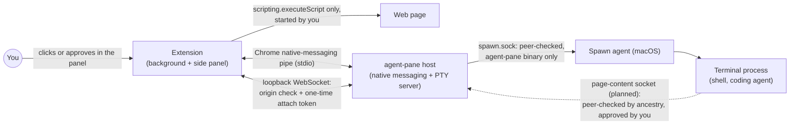

<p align="center">
  
</p>

<h1 align="center">Agent Pane</h1>
<p align="center">
  <a href="LICENSE"></a>
  <a href="https://go.dev/"></a>
  <a href="https://developer.chrome.com/docs/extensions/mv3/"></a>
</p>

<p align="center">
Claude Code, Codex and Pi in a real terminal, in Chrome's side panel.
</p>

For people who live in the TUI: each tab is a real local shell, not a chat box. An agent in that shell uses whatever browser tools it already has.

**Note:** this project is experimental. Agents run shell commands on your machine. Use with care.

## Why Agent Pane

The side panel is a terminal next to the browser, in the same window.

|                             | Agent Pane                                   | IDE / Terminal.app alone                   |
| --------------------------- | ------------------------------------------------ | ------------------------------------------ |
| Where the terminal sits     | Chrome side panel, beside the page               | A separate app                             |
| You stay in the loop        | Same window                                      | You switch away to watch a terminal        |
| One-click agents            | The agent commands your shell can already run    | Manual shells and PATH                     |

## Install

Chrome, then:

```sh
curl -fsSL https://raw.githubusercontent.com/asakin/agent-pane/main/install.sh | sh
```

The script downloads the binary for this machine, puts `~/.local/bin` on `PATH`, and writes the native-messaging manifest Chrome needs. On macOS it also starts a LaunchAgent that launches the shell, so programs the agent runs are not children of Chrome. If that manifest is not written, the script exits with an error. Running it again writes the same files again.

Then load the extension in Chrome:

1. Open `chrome://extensions`
2. Turn on **Developer mode**
3. Click **Load unpacked** and choose `~/.local/share/agent-pane/extensions/chrome` (the installer copies it from the release), or `extension/dist/chrome-mv3` from a checkout
4. Open the side panel from the Agent Pane extension icon

From a checkout, build the binary and point the same script at it:

```sh
git clone https://github.com/asakin/agent-pane.git
cd agent-pane
go build -o agent-pane .
AGENT_PANE_BIN="$PWD/agent-pane" ./install.sh
cd extension && npm install && npm run build
```

## How it works

It is a terminal in Chrome’s side panel: your shell, local files, `git`, language toolchains, existing CLI/agent tools, and whatever else is on your `PATH`. The extension does not attach to a browser and does not choose one. Browser automation is whatever CLI the agent runs.

## Usage

- **Tabs:** up to 8 terminals per Chrome window
- **One-Click Agent Launcher:** the side panel opens a shell. `+` runs the last agent you chose. The menu lists enabled agents that are on your `PATH`, then Terminal. Opening one moves it to the top unless Settings is set to keep the menu alphabetical
- **Settings:** shell, theme, font size, env, which agents are on, and the folder new agent tabs start in. The shell tab still starts in your home directory. Definitions live in `agents/` (see `agents/README.md`)

Terminal editing follows VS Code/Cursor conventions. Shift+Enter inserts a newline in
supporting agent CLIs; on macOS, Cmd+Enter does too. Cmd+Backspace deletes to the start
of the line, Cmd+Left/Right moves to its start/end, and Option+Left/Right moves by word.
Option+Backspace sends Ctrl+W (delete the previous whitespace-delimited word), and
Option+Delete deletes forward by word. On Windows/Linux, Ctrl+Backspace/Delete deletes
backward/forward by word. Option/Alt+Up/Down sends Ctrl+Up/Down.

On macOS, Cmd+A selects the terminal buffer, Cmd+K clears the visible terminal history,
and Escape clears a selection. Page Up/Down, Cmd+Home/End and Cmd+Option+Page Up/Down
scroll by page, to the top/bottom and by line respectively. Scrolling shortcuts apply
only to the normal buffer, leaving alternate-screen applications in control of page
navigation. Copy/paste uses the browser's normal shortcuts. Browser-reserved shortcuts
and Cursor's editor, pane, search and shell-integration commands are not remapped.

## Features

- **Session survival:** hide the side panel and open it again; the same tabs are still running

## Security

**What the extension can access, and why.** On Chrome it asks for `scripting` and access to all sites (`<all_urls>`), so that a terminal agent can be given the focused tab, a selection, or a page you are logged in to. Both are required at install, so Chrome asks once. The extension has no content scripts and no page listeners: page code runs only when you act in the panel, in Chrome's isolated world, and returns what it read once. It also uses `nativeMessaging` to talk to the local `agent-pane` host, and `tabs`, `sidePanel` and `storage` for the panel itself.

**How the parts talk.**



| Channel | Who can reach it | Who cannot |
| --- | --- | --- |
| Web page and extension | The extension, through `executeScript` after you act in the panel | Pages: there are no content scripts, no `externally_connectable`, and the background ignores messages that do not come from the extension's own pages |
| Extension and host | Chrome, which starts the host and owns its stdin/stdout | Pages and other processes: there is no listening port for this channel |
| Side panel and host | The extension's own origin, holding an attach token it got over native messaging | Pages (wrong origin) and local processes (no `Origin`, no token). A terminal id alone grants nothing |
| Host and spawn agent | The `agent-pane` binary running as you | Other users, and any other program running as you |
| Terminal process and host | A process descended from a live Agent Pane terminal, for a read you started or approved | Other processes running as you, and other users |

**What it protects against.**

- **Web pages** cannot run commands, attach to a terminal, read terminal output, or reach the host. The background only answers the extension's own pages. The terminal WebSocket on `127.0.0.1` accepts only the extension's origin, and each connection needs a one-time attach token handed out over native messaging. A token works once, and stops working when a newer one is issued for the same terminal or when the native-messaging connection closes.
- **Other processes running as you** cannot attach to a terminal with a terminal id alone, and on macOS cannot use the spawn helper's socket: it checks the connecting process's user and executable and accepts only `agent-pane` itself.

**What it does not protect against.** A process running as your user that reads Chrome's profile, or debugs other processes (Chrome, the host, a shell), can see what they see. Agent Pane cannot stop that; it only adds no new way in.

## Contributing

PRs welcome. For large changes, open an issue first. The extension runs page code only through `scripting.executeScript`, started by an extension action, and never adds `content_scripts` or `externally_connectable`. Page content goes to the host only over the native-messaging pipe. The full rules are in [AGENTS.md](AGENTS.md#security).

### Checks

Every pull request and every push to `main` runs [`.github/workflows/ci.yml`](.github/workflows/ci.yml) on Ubuntu. To run the same checks locally:

**extension** (Node 26):

```sh
cd extension
npm ci
npm run compile
npm test
npm run build
```

**go** (the Go version in `go.mod`):

```sh
gofmt -l .        # prints nothing when formatting is clean
go vet ./...
go test -race ./...
go build ./...
```

The extension job uploads `extension/dist/chrome-mv3` as the `extension-chrome-mv3` artifact, kept for 7 days. Download it from the workflow run's summary page, unzip it, and load the folder with **Load unpacked** in `chrome://extensions`.

## License

This project is licensed under the MIT License. See [LICENSE](LICENSE). Based on [Tweety](https://github.com/pomdtr/tweety) by Achille Lacoin.
