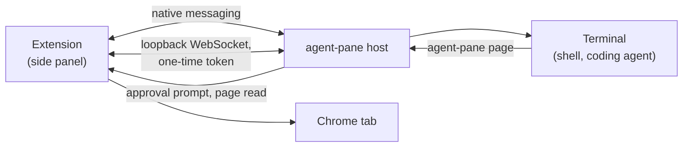

<p align="center">
  
</p>

<h1 align="center">Agent Pane</h1>
<p align="center">
  <a href="LICENSE"></a>
  <a href="https://github.com/asakin/agent-pane/actions/workflows/ci.yml"></a>
  <a href="https://github.com/asakin/agent-pane/releases"></a>
</p>

<p align="center">
Your coding agents, in Chrome's side panel.
</p>

Agent Pane puts a real terminal in Chrome's side panel and starts the coding agents you already use in it: Claude Code, Codex, Pi, OpenCode, Goose, or anything else on your `PATH`. Unlike a vendor's chat app, it is your agents, your tools and your files, running on your machine, in the same window as the page you are working on. When you ask an agent about the page beside it, it can read that page, with your permission.

Runs on macOS and Linux with Chrome and other Chromium browsers (Brave, Edge, Vivaldi, Chromium).

> **Experimental.** Agents run shell commands on your machine with your user account. Read [Security](#security) before using it.

## Install

Agent Pane is two parts: the Chrome extension and the `agent-pane` program it talks to on your computer. One command installs both from the latest [release](https://github.com/asakin/agent-pane/releases):

```sh
curl -fsSL https://github.com/asakin/agent-pane/releases/latest/download/install.sh | sh
```

Then add the extension to Chrome. Until the Chrome Web Store listing exists, load it from the folder the installer wrote:

1. Open `chrome://extensions` and turn on **Developer mode**
2. Click **Load unpacked** and choose `~/.local/share/agent-pane/extensions/chrome` (in the file dialog, **Cmd+Shift+.** on macOS shows hidden folders)
3. Open the side panel from the Agent Pane extension icon

The installer is published with each release and installs that release only: it downloads the release's archive for this machine, checks it against the release's `checksums.txt`, and runs the archive's `place.sh`. That script puts the program in `~/.local/bin`, adds `~/.local/bin` to `PATH`, writes the native-messaging manifest for each Chromium browser it finds, installs the [agent skill](#agent-skill), and on macOS starts the LaunchAgent that launches shells independently of Chrome. It also places a private, pinned copy of [herdr-core](https://github.com/herdrdev/herdr-core) at `~/.local/share/agent-pane/libexec/hc`, with its license and notices in `~/.local/share/agent-pane/licenses/herdr-core/`. It is never put on `PATH` or at `~/.local/bin/hc`, so a Herdr install of your own is not touched. Agent Pane runs pane tabs in it only when Options sets **Terminal backend** to Durable (preview); Built-in, the default, does not use it. It keeps a copy of the release in `~/.local/share/agent-pane/release` and ends by running `agent-pane doctor`. Nothing comes from the repository's `main` branch.

## Updating

Run the install command again, then click the reload button on the Agent Pane card in `chrome://extensions`. A run with nothing to change changes nothing. On macOS the LaunchAgent restarts, ending the shells open in pane tabs, when the program or its LaunchAgent plist changed, or when it is not running.

When the extension and the program are out of step, the side panel shows an update screen with the install command instead of opening a terminal. Run it, then click **Retry**.

1. Open `chrome://extensions` and turn on **Developer mode**.
2. Click **Load unpacked** and choose `~/.local/share/agent-pane/extensions/chrome`. In the file dialog, **Cmd+Shift+.** shows hidden folders on macOS.
3. Click the Agent Pane icon in the toolbar to open the side panel.

```sh
curl -fsSL https://github.com/asakin/agent-pane/releases/download/v0.3.0/install.sh | sh
```

## Checking and repairing an install

`agent-pane doctor` checks the files the installer owns against the installed release and reports each one, including that the bundled herdr-core has the pinned version and checksum and is not reachable as `hc` on `PATH`; `~/AGENTS.md` and `~/CLAUDE.md` are yours and are not checked. `agent-pane doctor --fix` puts the installed release back in place when a check fails. It uses only the copy in `~/.local/share/agent-pane/release`, downloads nothing, and does not change the version.

### Updating

Run the install command again, then click reload on the Agent Pane card in `chrome://extensions`. When the extension and the program are out of step, the side panel says so and shows the command. On macOS an update restarts the LaunchAgent, which ends the shells open in pane tabs.

`agent-pane doctor` checks the install and `agent-pane doctor --fix` repairs it from the local copy of the release. To install a specific version, use that release's installer, for example `.../releases/download/v0.3.0/install.sh`.

## Using it

**Pane tabs.** The side panel opens with a shell. `+` starts the agent you used last; its menu lists the enabled agents found on your `PATH`, then Terminal. Each pane tab is a separate terminal, and a Chrome window can have several. Hiding the side panel keeps them running; quitting Chrome ends them.

**The page beside the agent.** An agent can read the Chrome tab next to it by running `agent-pane page` with `info`, `selection`, `markdown`, `text` or `dom`. The first time a pane tab does this, the side panel asks you: **Allow this Chrome tab**, **Allow all Chrome tabs for this pane tab**, or **Deny**. An Allow holds until you close the pane tab; Deny refuses that one read. By default a pane tab reads whichever Chrome tab is active in its window; the lock in the status bar pins it to one. These commands only read, and Chrome keeps its own pages, the Web Store and the PDF viewer off limits.

**Send tab.** The **Send tab** button pastes the current page into the selected pane tab as Markdown, or another format from its menu, so you can edit it before pressing Enter.

**Blocked domains.** Options has a list of domains Agent Pane never reads, subdomains included. A block beats any approval, and it applies to Send tab too.

**Settings.** Options also sets the shell and its arguments, theme, font size, extra environment variables, which agents appear in the menu, and the folder agents start in. **Terminal backend** picks where new pane tabs run: Built-in (the default) or Durable (preview), which runs them in the terminal runtime bundled with Agent Pane. In the preview, pane tabs still end when Chrome or the host closes, and programs reach the page only through `AGENT_PANE_SOCKET` (no `AGENT_PANE_FD`). If Durable cannot start a pane tab, it runs in Built-in and the terminal says why. A Durable pane tab shows a mark in the tab strip when its program reports what it is doing: working, waiting for you (a pane tab out of sight that is waiting also gets underlined), done, error or idle. Programs report with `agent-pane status <state> [message]`; agents that report on their own show up without it. Agent definitions are small folders described in [agents/README.md](agents/README.md); drop your own into `~/.config/agent-pane/agents/` to add or replace one.

### Agent skill

The installer also installs a skill that tells coding agents they are inside Agent Pane and what `agent-pane page` offers. It goes into `~/.local/share/agent-pane/skills/agent-pane/`, with copies in `~/.claude/skills/agent-pane/` (Claude Code) and `~/.agents/skills/agent-pane/` (Codex, Pi, OpenCode, Goose, Cursor). Running the installer again refreshes those copies; a folder you created there yourself is left alone. To remove the skill, delete the folders.

Every terminal Agent Pane starts has `AGENT_PANE=1` set, so scripts and agents can tell where they are. The skill lists the other variables.

### Keyboard

Editing follows VS Code's terminal. On macOS:

| Keys | Does |
| --- | --- |
| Shift+Enter, Cmd+Enter | Newline in agent prompts that support it |
| Cmd+Backspace | Delete to the start of the line |
| Cmd+Left, Cmd+Right | Start or end of the line |
| Option+Left, Option+Right | Move by word |
| Option+Backspace, Option+Delete | Delete the word before or after the cursor |
| Cmd+A, Cmd+K | Select all, clear the screen |
| Page Up/Down, Cmd+Home/End | Scroll by page, to the top or bottom |

On Linux, Ctrl+Backspace and Ctrl+Delete delete by word and Alt+Left/Right move by word. Copy and paste use the browser's normal shortcuts.

## How it works



Chrome starts the `agent-pane` program through native messaging. The program starts your shell in a pseudo-terminal and streams it to the side panel over a loopback WebSocket that only the extension can open. On macOS a small LaunchAgent starts the shells so they are not tied to Chrome's process group.

A page read goes the other way: the program in the pane tab asks the host over a connection the host gave that terminal, the host knows which pane tab is asking and has the side panel prompt you if needed, and the extension reads the page. That connection is an inherited descriptor (`AGENT_PANE_FD`) or, for commands that did not inherit it, the terminal's own socket (`AGENT_PANE_SOCKET`) in a folder only you can open, which answers only processes started in that terminal and refuses any other. Durable (preview) pane tabs have only the socket. Approvals live in the host's memory, so restarting Chrome or the host starts every pane tab without one.

## Security

The extension asks for `nativeMessaging`, `scripting`, `tabs`, `sidePanel`, `storage` and access to all sites, the last two being what page reading needs. Everything on your machine runs as your user: a shell in a pane tab can do what you can do, and any other program running as you can read Chrome's profile, run `agent-pane`, or edit the installed files. Agent Pane is not a sandbox. Page content goes only to the terminal that asked for it: over its inherited descriptor, or over its page socket, which checks that the connecting process was started in that terminal. Report vulnerabilities privately as described in [SECURITY.md](SECURITY.md).

## Where it is going

The next step is making pane tabs outlive Chrome, so quitting the browser or updating Agent Pane does not end the agents in them, and letting agents in different pane tabs start, message and wait on each other. The design is [RFC 0001](rfcs/0001-herdr-core-backend.md); the work is tracked in the [issues](https://github.com/asakin/agent-pane/issues).

## Build from source

Go (version in `go.mod`) and Node are needed.

```sh
git clone https://github.com/asakin/agent-pane.git
cd agent-pane
scripts/dev-install.sh
```

`scripts/dev-install.sh` builds the program and the extension, lays them out like a release archive, and installs them with the same `place.sh` a release uses. It downloads nothing of Agent Pane; npm fetches the extension's dependencies, and the pinned herdr-core build from `scripts/herdr-core.lock` is downloaded once into `bin/herdr-core/`. The program reports version `dev`, which passes the side panel's version check, and `agent-pane doctor --fix` repairs from this build. Running the install command from [Install](#install) goes back to a release.

For the extension, load the build output instead of the installed copy, so a rebuild needs no install:

1. Open `chrome://extensions`, turn on **Developer mode**, click **Load unpacked** and choose `extension/dist/chrome-mv3` from the checkout
2. After a change, run `npm --prefix extension run build` and click the reload button on the Agent Pane card; close and reopen the side panel

Changes to the Go program, `agents/` or `skills/` need `scripts/dev-install.sh` again. On macOS that restarts the LaunchAgent, which ends the shells open in pane tabs.

### Checks

Every pull request and every push to `main` runs [`.github/workflows/ci.yml`](.github/workflows/ci.yml): extension and Go checks on Ubuntu, Go vet and race tests on macOS, the installer tests on both, and `goreleaser check`. To run the suite manually, open **Actions** → **ci** → **Run workflow**. To run the same checks locally:

## Contributing

Bug reports and focused pull requests are welcome. See [CONTRIBUTING.md](CONTRIBUTING.md) for the process and the checks to run, [AGENTS.md](AGENTS.md) for development notes, and [CODE_OF_CONDUCT.md](CODE_OF_CONDUCT.md) for community expectations.

## Terminology

| Term | Meaning |
| --- | --- |
| **Pane tab** | A terminal tab inside Agent Pane. |
| **Chrome tab** | A browser tab with a web page in it. |
| **Coding agent** | A program such as Claude Code, Codex or Pi running in a pane tab. |
| **Agent definition** | A launcher entry in `agents/<id>/`: a command, its arguments and an icon. |
| **PTY session** | One pseudo-terminal and the process running in it. A pane tab gets a new one when its program ends and the terminal is restarted. |

## Origins and license

Agent Pane started as a fork of [Agent Terminal](https://github.com/rishiskhare/agent-terminal) by Rishi Khare, itself based on [Tweety](https://github.com/pomdtr/tweety) by Achille Lacoin, and is now developed independently with a different focus. Thank you to both projects and their contributors. The Git history and copyright notices are preserved; earlier discussions remain in the [archived fork](https://github.com/asakin/agent-terminal).

Distributed under the [MIT License](LICENSE).

Release archives also carry a pinned build of [herdr-core](https://github.com/herdrdev/herdr-core) (`libexec/hc`), which is distributed under the Apache License 2.0. Its `LICENSE` and the third-party notices `hc --licenses` prints are in the archive's `licenses/herdr-core/` folder and are installed in `~/.local/share/agent-pane/licenses/herdr-core/`. The pinned version and its checksums are in [`scripts/herdr-core.lock`](scripts/herdr-core.lock).
