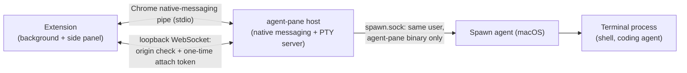

<p align="center">
  
</p>

<h1 align="center">Agent Pane</h1>
<p align="center">
  <a href="LICENSE"></a>
  <a href="https://go.dev/"></a>
  <a href="https://github.com/asakin/agent-pane/actions/workflows/ci.yml"></a>
  <a href="https://developer.chrome.com/docs/extensions/mv3/"></a>
</p>

<p align="center">
Claude Code, Codex and Pi in a real terminal, in Chrome's side panel.
</p>

For people who live in the TUI: each pane tab is a real local terminal. A coding agent in that terminal uses whatever browser tools it already has.

Agent Pane started from [Agent Terminal](https://github.com/rishiskhare/agent-terminal) and is now developed independently with a different focus. See [Origins and license](#origins-and-license) for attribution.

**Note:** this project is experimental. Agents run shell commands on your machine. Use with care.

## Why Agent Pane

The side panel is a terminal next to the browser, in the same window.

|                             | Agent Pane                                   | IDE / Terminal.app alone                   |
| --------------------------- | ------------------------------------------------ | ------------------------------------------ |
| Where the terminal sits     | Chrome side panel, beside the page               | A separate app                             |
| You stay in the loop        | Same window                                      | You switch away to watch a terminal        |
| One-click agents            | The agent commands your shell can already run    | Manual shells and PATH                     |

## Install

Agent Pane is two parts: the Chrome extension, and the `agent-pane` program it talks to on your computer. The install command puts both in place, from the latest [release](https://github.com/asakin/agent-pane/releases):

```sh
curl -fsSL https://github.com/asakin/agent-pane/releases/latest/download/install.sh | sh
```

Then add the extension to Chrome. Until the Chrome Web Store listing exists, load it from the folder the installer wrote:

1. Open `chrome://extensions` and turn on **Developer mode**
2. Click **Load unpacked** and choose `~/.local/share/agent-pane/extensions/chrome` (in the file dialog, **Cmd+Shift+.** on macOS shows hidden folders)
3. Open the side panel from the Agent Pane extension icon

The installer is published with each release and installs that release only: it downloads the release's archive for this machine, checks it against the release's `checksums.txt`, and runs the archive's `place.sh`. That script puts the program in `~/.local/bin`, adds `~/.local/bin` to `PATH`, writes the native-messaging manifest for each Chromium browser it finds, installs the [agent skill](#agent-skill), and on macOS starts the LaunchAgent that launches shells independently of Chrome. It keeps a copy of the release in `~/.local/share/agent-pane/release` and ends by running `agent-pane doctor`. Nothing comes from the repository's `main` branch.

## Updating

Run the install command again, then click the reload button on the Agent Pane card in `chrome://extensions`. A run with nothing to change changes nothing. On macOS the LaunchAgent restarts, ending the shells open in pane tabs, when the program or its LaunchAgent plist changed, or when it is not running.

When the extension and the program are out of step, the side panel shows an update screen with the install command instead of opening a terminal. Run it, then click **Retry**.

To install a particular release instead of the latest, use that release's installer:

```sh
curl -fsSL https://github.com/asakin/agent-pane/releases/download/v0.3.0/install.sh | sh
```

## Checking and repairing an install

`agent-pane doctor` checks the files the installer owns against the installed release and reports each one; `~/AGENTS.md` and `~/CLAUDE.md` are yours and are not checked. `agent-pane doctor --fix` puts the installed release back in place when a check fails. It uses only the copy in `~/.local/share/agent-pane/release`, downloads nothing, and does not change the version.

## How it works

It is a terminal in Chrome’s side panel: your shell, local files, `git`, language toolchains, existing CLI/agent tools, and whatever else is on your `PATH`.

## Terminology

| Term | Meaning |
| --- | --- |
| **Agent Pane** | The Chrome extension and its local host. |
| **Side panel** | The Chrome UI surface containing Agent Pane. |
| **Pane tab** | A terminal tab inside Agent Pane, regardless of which programs run in it. |
| **Chrome tab** | A browser tab containing a web page. |
| **Coding agent** | A program such as Claude Code, OpenCode, Codex, or Pi running in a pane tab. |
| **Agent definition** | A launcher entry in `agents/<id>/` describing a command, arguments, and icon. |
| **Shell** | The program that runs terminal commands, including coding agents. |
| **PTY session** | The host's pseudo-terminal and its associated process lifecycle. |
| **Factory run** | A Tessl automation execution working on this repository. |

## Usage

- **Pane tabs:** multiple terminals per Chrome window
- **One-Click Agent Launcher:** the side panel opens a shell. `+` runs the last agent you chose. The menu lists enabled agents that are on your `PATH`, then Terminal. Opening one moves it to the top unless Settings is set to keep the menu alphabetical
- **Settings:** shell, theme, font size, env, which agent definitions are enabled, and the folder pane tabs opened from an agent definition start in. Pane tabs opened with Terminal still start in your home directory. Definitions live in `agents/` (see `agents/README.md`)

Terminal editing follows VS Code/Cursor conventions. Shift+Enter inserts a newline in
supporting agent CLIs; on macOS, Cmd+Enter does too. Cmd+Backspace deletes to the start
of the line, Cmd+Left/Right moves to its start/end, and Option+Left/Right moves by word.
Option+Backspace sends Ctrl+W (delete the previous whitespace-delimited word), and
Option+Delete deletes forward by word. On Windows/Linux, Ctrl+Backspace/Delete deletes
backward/forward by word. Option/Alt+Up/Down sends Ctrl+Up/Down.

On macOS, Cmd+A selects the terminal buffer, Cmd+K clears the visible terminal history,
and Escape clears a selection. Page Up/Down, Cmd+Home/End and Cmd+Option+Page Up/Down
scroll by page, to the top/bottom and by line respectively. Scrolling shortcuts apply
only to the normal buffer, leaving alternate-screen applications in control of page
navigation. Copy/paste uses the browser's normal shortcuts.

## Features

- **Pane tab survival:** hide the side panel and open it again; the same terminals are still running

## Reading pages

Coding agents run `agent-pane page` commands inside a pane tab to read its associated Chrome tab. The status bar locks a pane tab to a particular Chrome tab; otherwise reads follow the active Chrome tab in that window. Commands print results to stdout and report errors on stderr with a non-zero exit status.

| Command | Prints |
| --- | --- |
| `agent-pane page info` | URL and title, one per line |
| `agent-pane page selection` | The selected text, or nothing |
| `agent-pane page text` | The page's visible text (`document.body.innerText`) |
| `agent-pane page dom` | The full DOM as HTML |
| `agent-pane page markdown [--full]` | The page as Markdown: the main article (Readability), or the whole body with `--full` or when the article is thin (Turndown). Starts with `# <title>`, the URL and a blank line |

The side panel prompts when a read is not covered by the pane tab's approval, with **Allow this Chrome tab**, **Allow all Chrome tabs for this pane tab**, and **Deny** choices. Reads that the approval covers proceed without another prompt.

- **Approval belongs to the pane tab.** It stays when a coding agent exits, when another one is started in the same pane tab, and when the side panel replaces a dead PTY session in that pane tab. Hiding and reopening the side panel keeps it. Closing the pane tab, or the Chrome window holding it, revokes it. A new pane tab starts with no approval, even if it runs the same coding agent.
- **The host owns pane-tab identity.** The host makes each pane tab's id and gives it only to the extension. A replacement PTY session joins a pane tab only when the extension names it and no live session holds it. Nothing running in the terminal can name another pane tab. Approvals are kept in host memory, so restarting the host or the browser starts every pane tab without approval.
- **A prompted read gets the document the prompt named.** The prompt shows the Chrome tab's committed URL. If the tab moves to another page before the read runs, the read fails and asks for the command to be run again. Later reads covered by an approval follow the Chrome tab wherever it navigates.
- **Pending requests are bounded.** A request gives up after three minutes and five seconds altogether, including time spent waiting to be written to a stalled native-messaging pipe. A request that has not started going out when it gives up is never written; one already partly written is finished so later messages stay intact, and it carries its expiry time so the extension refuses it instead of prompting. Messages to the extension over Chrome's 1 MB native-messaging limit are refused. It also ends when its PTY session closes or the `agent-pane page` process exits. When a PTY session ends, its pending requests fail and its descriptor stops working; the pane tab keeps its approval. At most 8 reads per PTY session and 32 across the host wait at once; the rest fail immediately.

**Send tab** beside the status bar pastes Chrome-tab content into the selected pane tab. It defaults to Markdown, with other formats in its menu. The pasted text can be edited before pressing Enter. It reports that nothing was sent if the pane tab changed, or was still reconnecting, while the Chrome tab was read.

### Environment

Every PTY session Agent Pane starts (plain shells, agent definitions and configured commands) gets these variables, and ordinary child processes inherit them. They are context, not credentials: a page read is decided by the host from the connection it arrives on, never from these values.

| Variable | Value |
| --- | --- |
| `AGENT_PANE` | `1`. |
| `TERM_PROGRAM` | `agent-pane`. Any inherited `TERM_PROGRAM_VERSION` is removed. |
| `AGENT_PANE_TAB_ID` | Opaque id of the pane tab (`tab-` and 32 hex digits). It stays the same when the side panel replaces a dead PTY session in that pane tab, and across a host restart. A new pane tab gets a new one. It is derived from, and does not reveal, the pane-tab id the host gives the extension. |
| `AGENT_PANE_SESSION_ID` | Opaque id of the PTY session (`session-` and 32 hex digits). Reattaching to a running session keeps it; a replacement session gets a new one. |
| `AGENT_PANE_AGENT` | The agent-definition id the launch chose, such as `claude`. Unset for Terminal and for a replacement started as a shell. It describes the launch only, not whatever runs in the terminal later. |
| `AGENT_PANE_FD` | The descriptor number of the session's page connection (`3`). Unset when the host could not make one. |
| `AGENT_PANE_SOCKET` | Path of the session's page socket, under `~/.local/share/agent-pane/run/`, for processes that did not inherit the descriptor. Unset when the host could not make one. The socket is removed when the PTY session ends. |
| `AGENT_PANE_SKILL_PATH` | The installed [skill](#agent-skill), when the installer has put it in place. |

These names are reserved. Values inherited by the host (for example a host started from inside a pane tab) and entries in the Settings env are replaced, and a variable with no value for this session is removed. Other variables, `PATH` included, keep their inherited or configured values. A program sees the values from when its PTY session started; a later replacement session does not change them for programs still running elsewhere.

### Agent skill

`skills/agent-pane/SKILL.md` teaches coding agents to detect Agent Pane and read the Chrome tab with `agent-pane page`. The installer copies it to `~/.local/share/agent-pane/skills/agent-pane/` and installs a copy in each user skills folder the supported agents read:

| Folder | Read by |
| --- | --- |
| `~/.claude/skills/agent-pane/` | Claude Code; OpenCode, Goose and Cursor also read it |
| `~/.agents/skills/agent-pane/` | Codex, Pi, OpenCode, Goose and Cursor |

Each copy holds an `.agent-pane-managed` marker. Installing again replaces marked copies with the current skill. A folder of that name without the marker, or a symlink, belongs to you and is left alone with a warning. To remove the skill, delete the `agent-pane` folders; the installer has no uninstall step. The skill reaches an agent started from Terminal too, because these are user-level folders. `~/AGENTS.md` and `~/CLAUDE.md`, when they hold the Agent Pane block, also point to it. An agent configured to read skills from elsewhere (for example `CLAUDE_CONFIG_DIR` or `PI_CODING_AGENT_DIR`) does not see these copies; point it at `$AGENT_PANE_SKILL_PATH`.

`agent-pane page` uses the inherited descriptor when it has one. Some command tools start commands with only stdin, stdout and stderr; Claude Code's Bash tool does (checked with 2.1.287 on Linux). Such a command falls back to `AGENT_PANE_SOCKET`. The host answers a connection on that socket only when the connecting process, checked by peer credentials, has the host's uid and is the process the PTY session started or one of its descendants. Knowing the path grants nothing to a process started elsewhere, which gets `only processes started in it may read its page`. On macOS, an older spawn agent does not report the pid it started; the socket is then not served until the installer is run again.

Markdown output rewrites link and image targets as absolute URLs, resolved against the page's `<base href>` when it has one.

### Blocked domains

**Blocked domains** in Options lists domains whose pages Agent Pane never reads. The list starts empty and is saved in `config.json` as `blockedDomains`; adding or removing an entry saves it at once, applied to the list as it is stored then, so an entry another Options page saved earlier is kept. Two Options pages editing at the same moment can still lose one of the edits, because the host replaces the whole list on each save.

- **An entry covers its domain and subdomains.** `bank.example` blocks `bank.example` and `login.bank.example`, but not `notbank.example` or `bank.example.evil.test`. Entries are hostnames: letter case, trailing dots and ports are ignored, and a pasted URL is reduced to its hostname. Wildcards, paths and spaces are refused.
- **A block applies to every read.** It covers all `agent-pane page` formats and Send tab. A pane tab's approval does not override it, and a blocked page never gets an approval prompt. A refused read reports `blocked: the page's domain matches <entry> in Agent Pane's Blocked domains` and returns no page data.
- **The current list is checked against the actual page.** Each read loads the list again and checks the Chrome tab's page and any navigation in progress before prompting, again when an approval arrives, inside the page before reading it, and again against that document and the Chrome tab before the result is delivered. Send tab checks the document it read once more just before pasting, even if the Chrome tab has moved on. A block added, or a navigation or redirect to a blocked page, while a read is under way stops that read. If the list cannot be loaded, the read fails.
- **Changes apply to existing pane tabs.** Removing an entry lets pages on that domain go through the normal approval flow again. It grants nothing; an approval the pane tab already had still applies.

Chrome restricts extension access to protected pages, including `chrome://` pages, the Chrome Web Store, other extensions' pages, and its built-in PDF viewer. Reads of these pages report an error.

## Security

The following describes the current implementation and its limitations.

**What the extension can access.** On Chrome it requests `scripting` and access to all sites (`<all_urls>`), for [page reading](#reading-pages). It uses `nativeMessaging` to talk to the local `agent-pane` host, and `tabs`, `sidePanel` and `storage` for the side panel.

**How the parts talk.**



**Connection checks.**

The background accepts messages from the extension's own pages. Terminal WebSocket connections use the extension's origin and a one-time attach token obtained over native messaging. A token expires when used, when replaced by a newer token for that terminal, or when the native-messaging connection closes.

On macOS, the spawn helper checks the connecting process's user and executable (`proc_pidpath`) and accepts the `agent-pane` binary running as that user.

**Local machine access.**

- A process running as your user that reads Chrome's profile, or debugs other processes (Chrome, the host, a shell), can see what they see.
- A process running as your user that runs `agent-pane` itself gets what `agent-pane` can do, including a shell from the macOS spawn agent.
- A process running as your user that edits `~/.local/bin/agent-pane`, the host wrapper in `~/.local/share/agent-pane`, the native-messaging manifests, or the LaunchAgent plist (`~/Library/LaunchAgents/com.agentpane.spawn.plist`) controls what Chrome and launchd start.

## Contributing

See [CONTRIBUTING.md](CONTRIBUTING.md) for the contribution process and [CODE_OF_CONDUCT.md](CODE_OF_CONDUCT.md) for community expectations. Report vulnerabilities privately using [SECURITY.md](SECURITY.md).

### Build from source

To work on Agent Pane, or to run code that is not released yet, build and install it from a checkout (Go and Node are needed):

```sh
git clone https://github.com/asakin/agent-pane.git
cd agent-pane
scripts/dev-install.sh
```

`scripts/dev-install.sh` builds the program and the extension, lays them out like a release archive, and installs them with the same `place.sh` a release uses. It downloads nothing of Agent Pane; npm fetches the extension's dependencies. The program reports version `dev`, which passes the side panel's version check, and `agent-pane doctor --fix` repairs from this build. Running the install command from [Install](#install) goes back to a release.

For the extension, load the build output instead of the installed copy, so a rebuild needs no install:

1. Open `chrome://extensions`, turn on **Developer mode**, click **Load unpacked** and choose `extension/dist/chrome-mv3` from the checkout
2. After a change, run `npm --prefix extension run build` and click the reload button on the Agent Pane card; close and reopen the side panel

Changes to the Go program, `agents/` or `skills/` need `scripts/dev-install.sh` again. On macOS that restarts the LaunchAgent, which ends the shells open in pane tabs.

### Checks

Every pull request and every push to `main` runs [`.github/workflows/ci.yml`](.github/workflows/ci.yml): extension and Go checks on Ubuntu, Go vet and race tests on macOS, the installer tests on both, and `goreleaser check`. To run the suite manually, open **Actions** → **ci** → **Run workflow**. To run the same checks locally:

**extension** (Node 26):

```sh
cd extension
npm ci
npm run compile
npm test
npm run build
```

**go** (the Go version in `go.mod`):

```sh
gofmt -l .        # prints nothing when formatting is clean
go vet ./...
go test -race ./...
go build ./...
sh scripts/install_test.sh   # install.sh, place.sh and doctor, in a temporary HOME
```

The extension job uploads `extension/dist/chrome-mv3` as the `extension-chrome-mv3` artifact, kept for 7 days. Download it from the workflow run's summary page, unzip it, and load the folder with **Load unpacked** in `chrome://extensions`.

### Skill evals

[`.github/workflows/skill-evals.yml`](.github/workflows/skill-evals.yml) runs [Tessl](https://tessl.io) evals for the [agent skill](#agent-skill): the scenarios in `skills/agent-pane/evals/`, with `skills/agent-pane` as the context under test. It is advisory: it runs only when a maintainer starts it, never on a push or pull request, and is not a required check. To run it, open **Actions** → **skill-evals** → **Run workflow**, pick the branch, and optionally change the run label (default `agent-pane skill eval`). The job waits for the run and fails if the eval run fails; open the run in Tessl for the scores. It needs a Tessl API token for the `siglify/agent-pane` project stored as the `TESSL_TOKEN` repository secret. To run the same evals locally:

```sh
tessl eval run skills/agent-pane --label "agent-pane skill eval"
```

## Origins and license

Agent Pane is an independently maintained project derived from [Agent Terminal](https://github.com/rishiskhare/agent-terminal) by Rishi Khare, itself based on [Tweety](https://github.com/pomdtr/tweety) by Achille Lacoin. Thank you to both projects and their contributors for the foundation.

Agent Pane follows its own development direction and is not an official release of either predecessor. The original Git history and copyright notices are preserved. Earlier issues and pull request discussions remain in the [archived development fork](https://github.com/asakin/agent-terminal); new contributions belong in this repository.

Distributed under the [MIT License](LICENSE).
