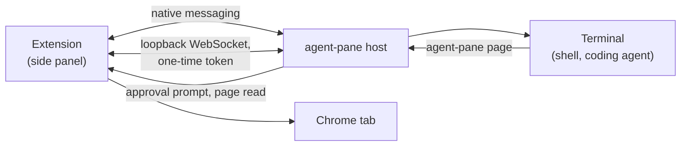

<p align="center">
  
</p>

<h1 align="center">Agent Pane</h1>
<p align="center">
  <a href="LICENSE"></a>
  <a href="https://github.com/asakin/agent-pane/actions/workflows/ci.yml"></a>
  <a href="https://github.com/asakin/agent-pane/releases"></a>
</p>

<p align="center">
Coding agents in Chrome's side panel, next to the page they are working on.
</p>

Agent Pane is a real terminal in Chrome's side panel. Open it, pick Claude Code, Codex, Pi, OpenCode or Goose, and the agent starts in a terminal beside the page you are looking at. When you ask it about "this page", it reads that page itself with `agent-pane page`, once you have allowed it. You never switch windows, and you never paste a page into a chat.

Runs on macOS and Linux with Chrome and other Chromium browsers (Brave, Edge, Vivaldi, Chromium).

> **Experimental.** Agents run shell commands on your machine with your user account. Read [Security](#security) before using it.

## Install

Agent Pane is two parts: the Chrome extension and the `agent-pane` program it talks to on your computer. One command installs both from the latest [release](https://github.com/asakin/agent-pane/releases):

```sh
curl -fsSL https://github.com/asakin/agent-pane/releases/latest/download/install.sh | sh
```

Then load the extension in Chrome (there is no Web Store listing yet):

1. Open `chrome://extensions` and turn on **Developer mode**.
2. Click **Load unpacked** and choose `~/.local/share/agent-pane/extensions/chrome`. In the file dialog, **Cmd+Shift+.** shows hidden folders on macOS.
3. Click the Agent Pane icon in the toolbar to open the side panel.

The installer puts `agent-pane` in `~/.local/bin`, registers it with each Chromium browser it finds, installs the [agent skill](#agent-skill), starts a LaunchAgent on macOS, and finishes with `agent-pane doctor`. It installs released code only, checked against the release's `checksums.txt`.

### Updating

Run the install command again, then click reload on the Agent Pane card in `chrome://extensions`. When the extension and the program are out of step, the side panel says so and shows the command. On macOS an update restarts the LaunchAgent, which ends the shells open in pane tabs.

`agent-pane doctor` checks the install and `agent-pane doctor --fix` repairs it from the local copy of the release. To install a specific version, use that release's installer, for example `.../releases/download/v0.3.0/install.sh`.

## Using it

**Pane tabs.** The side panel opens with a shell. `+` starts the agent you used last; its menu lists the enabled agents found on your `PATH`, then Terminal. Each pane tab is a separate terminal, and a Chrome window can have several. Hiding the side panel keeps them running; quitting Chrome ends them.

**Reading the page.** An agent reads the Chrome tab beside it by running `agent-pane page`:

| Command | Prints |
| --- | --- |
| `agent-pane page info` | URL and title |
| `agent-pane page selection` | The text you selected on the page |
| `agent-pane page markdown` | The main article as Markdown, or the whole page with `--full` |
| `agent-pane page text` | The visible text |
| `agent-pane page dom` | The page's HTML |

The first time a pane tab reads a Chrome tab, the side panel asks: **Allow this Chrome tab**, **Allow all Chrome tabs for this pane tab**, or **Deny**. The answer holds until you close the pane tab, whatever runs in it. By default a pane tab reads whichever Chrome tab is active in its window; the lock in the status bar pins it to one Chrome tab. These commands only read. Chrome does not let extensions read its own pages, the Web Store or the PDF viewer.

**Send tab.** The **Send tab** button pastes the current page into the selected pane tab as Markdown, or another format from its menu, so you can edit it before pressing Enter.

**Blocked domains.** Options has a list of domains Agent Pane never reads, subdomains included. A block beats any approval, and it applies to Send tab too.

**Settings.** Options also sets the shell and its arguments, theme, font size, extra environment variables, which agents appear in the menu, and the folder agents start in. Agent definitions are small folders described in [agents/README.md](agents/README.md); drop your own into `~/.config/agent-pane/agents/` to add or replace one.

### Agent skill

The installer also installs a skill that tells coding agents they are inside Agent Pane and how to read the page. It goes into `~/.local/share/agent-pane/skills/agent-pane/`, with copies in `~/.claude/skills/agent-pane/` (Claude Code) and `~/.agents/skills/agent-pane/` (Codex, Pi, OpenCode, Goose, Cursor). Running the installer again refreshes those copies; a folder you created there yourself is left alone. To remove the skill, delete the folders.

Every terminal Agent Pane starts has `AGENT_PANE=1` set, so scripts and agents can tell where they are. The skill lists the other variables.

### Keyboard

Editing follows VS Code's terminal. On macOS:

| Keys | Does |
| --- | --- |
| Shift+Enter, Cmd+Enter | Newline in agent prompts that support it |
| Cmd+Backspace | Delete to the start of the line |
| Cmd+Left, Cmd+Right | Start or end of the line |
| Option+Left, Option+Right | Move by word |
| Option+Backspace, Option+Delete | Delete the word before or after the cursor |
| Cmd+A, Cmd+K | Select all, clear the screen |
| Page Up/Down, Cmd+Home/End | Scroll by page, to the top or bottom |

On Linux, Ctrl+Backspace and Ctrl+Delete delete by word and Alt+Left/Right move by word. Copy and paste use the browser's normal shortcuts.

## How it works



Chrome starts the `agent-pane` program through native messaging. The program starts your shell in a pseudo-terminal and streams it to the side panel over a loopback WebSocket that only the extension can open. On macOS a small LaunchAgent starts the shells so they are not tied to Chrome's process group.

When a program in a pane tab runs `agent-pane page`, it talks back to the host over a connection the host handed to that terminal. The host knows which pane tab the request came from, asks the side panel to prompt you if that pane tab has no approval yet, and reads the page through the extension. Nothing in the terminal can name another pane tab or read without going through this path, and approvals live in the host's memory, so restarting Chrome or the host starts every pane tab without one.

## Security

The extension asks for `nativeMessaging`, `scripting`, `tabs`, `sidePanel`, `storage` and access to all sites, the last two being what page reading needs. Everything on your machine runs as your user: a shell in a pane tab can do what you can do, and any other program running as you can read Chrome's profile, run `agent-pane`, or edit the installed files. Agent Pane is not a sandbox. Report vulnerabilities privately as described in [SECURITY.md](SECURITY.md).

## Where it is going

The next step is making pane tabs outlive Chrome, so quitting the browser or updating Agent Pane does not end the agents in them, and letting agents in different pane tabs start, message and wait on each other. The design is [RFC 0001](rfcs/0001-herdr-core-backend.md); the work is tracked in the [issues](https://github.com/asakin/agent-pane/issues).

## Build from source

Go (version in `go.mod`) and Node are needed.

```sh
git clone https://github.com/asakin/agent-pane.git
cd agent-pane
scripts/dev-install.sh
```

This builds the program and the extension and installs them the way a release does, reporting version `dev`. Load `extension/dist/chrome-mv3` from the checkout with **Load unpacked** so the extension picks up rebuilds: after a change, run `npm --prefix extension run build` and reload the extension. Changes to the Go program, `agents/` or `skills/` need `scripts/dev-install.sh` again. The install command above returns you to a release.

## Contributing

Bug reports and focused pull requests are welcome. See [CONTRIBUTING.md](CONTRIBUTING.md) for the process and the checks to run, [AGENTS.md](AGENTS.md) for development notes, and [CODE_OF_CONDUCT.md](CODE_OF_CONDUCT.md) for community expectations.

## Terminology

| Term | Meaning |
| --- | --- |
| **Pane tab** | A terminal tab inside Agent Pane. |
| **Chrome tab** | A browser tab with a web page in it. |
| **Coding agent** | A program such as Claude Code, Codex or Pi running in a pane tab. |
| **Agent definition** | A launcher entry in `agents/<id>/`: a command, its arguments and an icon. |
| **PTY session** | One pseudo-terminal and the process running in it. A pane tab gets a new one when its program ends and the terminal is restarted. |

### Skill evals

[`.github/workflows/skill-evals.yml`](.github/workflows/skill-evals.yml) runs [Tessl](https://tessl.io) evals for the [agent skill](#agent-skill): the scenarios in `skills/agent-pane/evals/`, with `skills/agent-pane` as the context under test. It is advisory: it runs only when a maintainer starts it, never on a push or pull request, and is not a required check. To run it, open **Actions** → **skill-evals** → **Run workflow**, pick the branch, and optionally change the run label (default `agent-pane skill eval`). The job waits for the run and fails if the eval run fails; open the run in Tessl for the scores. It needs a Tessl API token for the `siglify/agent-pane` project stored as the `TESSL_TOKEN` repository secret. To run the same evals locally:

```sh
tessl eval run skills/agent-pane --label "agent-pane skill eval"
```

## Origins and license

Agent Pane started as a fork of [Agent Terminal](https://github.com/rishiskhare/agent-terminal) by Rishi Khare, itself based on [Tweety](https://github.com/pomdtr/tweety) by Achille Lacoin, and is now developed independently with a different focus. Thank you to both projects and their contributors. The Git history and copyright notices are preserved; earlier discussions remain in the [archived fork](https://github.com/asakin/agent-terminal).

Distributed under the [MIT License](LICENSE).
