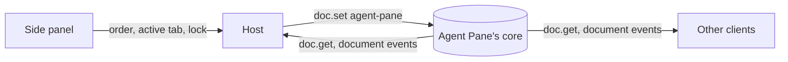

# RFC 0004: A layout document for Durable pane tabs

- **Status:** Proposed
- **Issue:** None yet
- **Author:** Claude, for @asakin

## Summary

Agent Pane records how its Durable pane tabs are arranged as a document in its own herdr-core: one space per Chrome window, one tab per pane tab, in order, with names. The host writes it, the side panel restores from it, and any other client of that core can read it. The document uses the layout shape the Herdr app uses for its own layout, so a program that reads one can read the other. Agent Pane stays a separate client of its own core and writes nothing that addresses another app.

## Motivation

A Durable pane tab is described in three places today, and none of them is the arrangement.

| Where | What it holds | Who can read it |
| --- | --- | --- |
| Labels on the core terminal | `agent-pane.session`, `agent-pane.pane`, `agent-pane.agent`, `agent-pane.window` (`internal/cmd/backend_core.go`) | any client of the core |
| `~/.local/share/agent-pane/state/panes.json` | the join from those public ids to the host's session id, the secret pane id, the page socket and the browser id (`internal/cmd/registry.go`) | the host only |
| `storage.session` in the extension | per Chrome window: the pane tabs in order, the active one, and each tab's lock to a Chrome tab (`WindowTabState` in `extension/entrypoints/shared/windowTabs.ts`) | that browser's extension, until Chrome quits |

Three things follow from that split.

**The arrangement does not survive Chrome.** `storage.session` is [cleared when the browser restarts](https://developer.chrome.com/docs/extensions/reference/api/storage#storage_areas). The programs keep running in the core and the host finds them again, but the `agent-pane.window` label names a window of a browser run that no longer exists, so every pane tab lands in the Running pane tabs list (`extension/entrypoints/shared/runningTabs.ts`) to be opened one at a time. Their order, which one was active, which window they shared and which Chrome tab each was locked to are gone.

**No other client can see the arrangement.** The core holds a flat set of terminals. A client that lists them, such as a Herdr app that has Agent Pane's core added as a machine or a tool that shows agents across several cores, can group by the window label but has no order, no tab names and no notion of a space. It has to invent one.

**The shortcut is to borrow another app's labels.** Putting the Herdr app's `herdr.space` and `herdr.tab` labels on pane tabs makes a Herdr app place them, and that was tried in [#88](https://github.com/asakin/agent-pane/pull/88). Those labels are an instruction to a Herdr app, not a description of Agent Pane's layout: the pane tabs appear as a space Herdr made, named Herdr's way, and Herdr writes its own layout document into Agent Pane's core. [docs/herdr-core-integration.md](../herdr-core-integration.md) already says not to use them unless intentionally interoperating with the Herdr app.

## Guide-level explanation

### For a person using Agent Pane

Pane tabs belong to a space, and a space is what one Chrome window's side panel shows. Nothing changes while Chrome is running.

After Chrome quits and starts again, the side panel offers the spaces that are shown in no window, each with its pane tabs in their order and with their names, and opens a whole space at once. Opening pane tabs one by one from the Running pane tabs list remains possible.

### For another client of the core

The document `agent-pane` in Agent Pane's core lists the spaces. Each space has tabs; each tab names one core terminal. A client reads it with `doc.get` and learns of changes from the core's document events. Programs started with `agent-pane run` are not tabs: they are found, as today, as terminals whose `parent` is a pane tab's terminal.

## Reference-level explanation

### The document

The host writes one document, `agent-pane`, in the private core (`HC_SESSION=agent-pane`). Illustrative value:

```json
{
  "spaces": [
    {
      "id": "sp-1a2b…",
      "name": "",
      "folder": "",
      "tabs": [
        {
          "id": "tab-3c4d…",
          "name": "Claude Code",
          "root": { "id": "tab-3c4d…", "type": "block", "content": { "terminal": "t7" } },
          "agentPane": { "agent": "claude", "lockedTab": 1024 }
        }
      ],
      "agentPane": { "window": "<browserId>:<windowId>@<runId>", "active": "tab-3c4d…" }
    }
  ]
}
```

- `spaces`, `id`, `name`, `folder`, `tabs` and a tab's `root` tree of `block` nodes with `content.terminal` are the Herdr app's layout shape, as it appears in the `herdr-app` document that app keeps in a core. A pane tab holds one terminal, so its `root` is always a single block.
- Everything specific to Agent Pane sits under an `agentPane` key on the space or tab, so a reader of the shared shape can ignore it.
- A tab's `id` is the pane tab's public id, the value of the `agent-pane.pane` label. A space's `id` is made by the host when the space is created. The secret pane id and the page socket path never appear, as with labels today.
- Only Durable pane tabs are listed. A Built-in pane tab is not a core terminal and ends with its host.

### Who writes and who reads



The host is the only writer. It writes when a pane tab is created, attached, detached or destroyed, and when the side panel reports a change of order, of the active tab or of a lock. The host is not told the order or the active tab today, so the side panel needs one new native-messaging call for it.

Each browser runs its own host, so several hosts write the same document. `doc.set` carries the version the writer read; a host that loses the race reads again and reapplies its change. The exact conflict answer of the pinned herdr-core is to be confirmed against `hc schema`.

Any client of the core can call `doc.set`, so the host treats what it reads as untrusted. It never takes a session id, a pane id, a socket path or a grant from the document: those stay in `panes.json`. A tab in the document with no matching record is ignored, and a live terminal with a record and no tab is added back.

### What stays where

- Labels stay as they are. They are how the host finds its terminals before it has read anything else.
- `panes.json` stays the host-private join to secret ids.
- `storage.session` stays the side panel's working copy while Chrome runs. On start, the panel asks the host, which answers from the document.

### Restoring

`tty.list` gains the space and position of each Durable pane tab. A space whose window is not open in this browser run is offered to the side panel as a whole. Taking it rewrites that space's `agentPane.window` to the new window.

### Testing

The document logic is tested against the fake core in `internal/cmd`, and against the pinned core with `AGENT_PANE_TEST_HC`. The extension side is covered in `extension/tests`.

## Drawbacks

- The layout shape is the Herdr app's and is not a published specification. A change there would leave Agent Pane's document readable only by its own code.
- A fourth place describes a pane tab. The proposal limits the overlap by making the document the only record of arrangement, but the host must keep it consistent with labels and `panes.json`.
- The document is written on every reorder and tab switch.

## Rationale and alternatives

- **The Herdr app's labels ([#88](https://github.com/asakin/agent-pane/pull/88)).** Small, and it makes a Herdr app show the pane tabs at once. It hands the arrangement to another app, gives every reader Herdr's naming, and helps no client that is not a Herdr app.
- **More `agent-pane.*` labels** (order, space, name). No new mechanism, but an arrangement spread over per-terminal labels cannot be changed atomically, and several hosts would race on it.
- **`storage.local` in the extension.** Survives a Chrome restart, but only that browser profile can read it, and no other client sees it.
- **A shape of Agent Pane's own.** Free of any dependency, but every reader needs code for it, and the two shapes describe the same things.

## Prior art

- The Herdr app keeps its layout as a document in the core it uses, and reads the same document from each machine it shows.
- tmux exposes sessions, windows and panes to any client through `list-sessions`, `list-windows` and `list-panes`, which is what lets other tools attach to an arrangement they did not create.
- Chrome's own session restore brings back windows with their tabs in order, which is the behavior a person expects of the pane tabs beside them.

## Unresolved questions

- **What a space is.** One per Chrome window is the simplest mapping, but a window id does not survive a Chrome restart. Should a space instead be a named set a person keeps, shown in whichever window opens it?
- **Source of truth.** Is the document what the side panel restores from, as proposed, or a published copy of state the extension keeps elsewhere?
- **The shared shape.** Is the Herdr app's layout shape stable enough to adopt, and would herdr-core document it?
- **Other writers.** Should a client such as a Herdr app be able to reorder or rename pane tabs by writing the document, or is it read-only for everyone but the host?
- **The document's name.** `agent-pane` follows the Herdr app's `herdr-app`.

## Future possibilities

- **A pane tab bound to a Chrome tab.** Today a pane tab can be locked to a Chrome tab for page reads while the side panel stays per window. A side panel per Chrome tab would make the Chrome tab, not the window, what a space or tab belongs to. The `agentPane` keys are where that tie would be recorded.
- **Workspaces.** RFC 0001 lists saving a set of pane tabs and starting them together. A saved space is that set.
- **Moving a pane tab between windows** becomes a change to two spaces in one write.
- **One list of agents across cores.** A client that reads this document and the Herdr app's can show both arrangements without either app knowing about the other.
