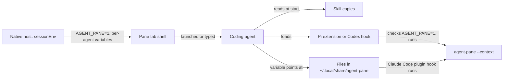

# RFC 0005: Deliver the agent-pane skill to agents in pane tabs

- **Status:** Proposed
- **Issue:** #73
- **Author:** Tessl, for @asakin

## Summary

Every coding agent started in a pane tab, from the launcher or typed in the pane tab's shell, should know it is in Agent Pane and know how to use the `agent-pane` skill. Agents run anywhere else should not be told so. Today the installer writes an Agent Pane block into `~/AGENTS.md` and `~/CLAUDE.md`, which no shipped agent reads as a global file and which claims "You are in the Agent Pane side panel" wherever it is read.

This RFC proposes the pattern Herdr, Warp and Wave use: global skill copies and integrations that do nothing unless the pane tab's `AGENT_PANE=1` is set, plus per-agent environment variables that only pane tabs carry. Concretely:

- The installer stops writing the block into `~/AGENTS.md` and `~/CLAUDE.md`, and removes an existing one on update.
- The skill copies in `~/.agents/skills/` and `~/.claude/skills/` stay; they already tell an agent to stop when `AGENT_PANE` is unset.
- Pane tabs get `CLAUDE_CODE_PLUGIN_DIRS` (Claude Code 2.1.280 or later), `OPENCODE_CONFIG_CONTENT` (OpenCode) and `GOOSE_MOIM_MESSAGE_FILE` (Goose), each pointing at files in Agent Pane's own data folder.
- The installer writes a Pi extension and a Codex `SessionStart` hook, each inert outside pane tabs. Codex runs the hook only after the person trusts it once in `/hooks`.
- Cursor, disabled in the launcher, gets the skill copies only.

`agent-pane doctor` and `scripts/install_test.sh` cover every file the installer writes. The work is one implementation pull request.

## Motivation

### What the installer writes today

`write_instructions` in [`scripts/place.sh`](../../scripts/place.sh) (and `writeInstructions` in [`internal/cmd/place.go`](../../internal/cmd/place.go) on Windows) does three things:

1. Copies [`scripts/instructions.md`](../../scripts/instructions.md) to `~/.config/agent-pane/AGENTS.md`.
2. Puts the same text, between `<!-- agent-pane:start -->` and `<!-- agent-pane:end -->`, into `~/AGENTS.md`.
3. Puts a block holding `@AGENTS.md` into `~/CLAUDE.md`.

`upsert_managed` creates either file when it is missing, but leaves an existing file without the markers unchanged, so on a machine where the person already has a `~/AGENTS.md` or `~/CLAUDE.md` the block never lands. `sync_skill` copies the skill to `~/.local/share/agent-pane/skills/agent-pane/`, with owned copies in `~/.agents/skills/agent-pane/` and `~/.claude/skills/agent-pane/`.

### Why it does not work

No shipped agent reads `~/AGENTS.md` or `~/CLAUDE.md` as its global instructions file. Each has its own global file, and reads a file in the home folder only by walking up from a working directory beneath it:

| Agent | Global instructions file | Reads `~/AGENTS.md` | Source |
| --- | --- | --- | --- |
| Claude Code 2.1.290 | `~/.claude/CLAUDE.md` | No (tried); `AGENTS.md` only in the project tree | [memory docs](https://code.claude.com/docs/en/memory#agents-md) |
| Codex 0.155.1 | `~/.codex/AGENTS.md` | No (tried with `codex debug prompt-input`) | [AGENTS.md guide](https://developers.openai.com/codex/guides/agents-md) |
| Pi 1.6.1 | `~/.pi/agent/AGENTS.md` | Only when the working directory is under `~` (tried) | [`resource-loader.ts`](https://github.com/earendil-works/pi/blob/main/packages/coding-agent/src/core/resource-loader.ts) |
| OpenCode 1.19.6 | `~/.config/opencode/AGENTS.md` | Only outside a git repository (tried) | [`instruction.ts`](https://github.com/anomalyco/opencode/blob/v1.19.6/packages/opencode/src/session/instruction.ts) |
| Goose 1.61.1 | `~/.config/goose/AGENTS.md`, `~/.agents/AGENTS.md` | Only when the git root or working directory is `~` (tried) | [`load_hints.rs`](https://github.com/aaif-goose/goose/blob/v1.61.1/crates/goose/src/hints/load_hints.rs) |
| Cursor CLI 2026.11.22 | User rules in the app | Not documented | [rules docs](https://cursor.com/docs/rules) |

Where the block is read, it is read outside Agent Pane too, and tells an agent in another terminal that it is in the side panel.

The skill copies reach every agent: Claude Code reads `~/.claude/skills`, Codex and Pi read `~/.agents/skills`, and OpenCode, Goose and Cursor read both (see [Agent coverage](#agent-coverage)). What they lack is the fact that this session runs in a pane tab. The skill's description ends "and AGENT_PANE=1 is set", and an agent does not know that unless it checks. Today the person can fill the gap by hand: `agent-pane --skill` prints the skill, and the side panel's **Teach agent** button types `Run agent-pane --skill and follow what it prints for the rest of this session.` into the selected pane tab ([README](../../README.md#agent-skill)).

### Goals

From the issue, the design has to show that:

- in a pane tab, each shipped agent, started from the launcher or typed in the shell, answers "how do I read the page next to me?" correctly without being told;
- outside a pane tab, nothing changes for any agent;
- nothing pane-specific is written into files agents read outside Agent Pane, unless that is established practice;
- `agent-pane doctor` and `scripts/install_test.sh` cover whatever the installer writes.

## Guide-level explanation

### For a person using Agent Pane

After installing or updating, an agent started in a pane tab knows where it is. Asked "what does this page say?", it runs `agent-pane page markdown` instead of asking for a paste. **Teach agent** stays for agents that miss it, such as Claude Code before 2.1.280 or Codex before its hook is trusted.

The installer no longer touches `~/AGENTS.md` or `~/CLAUDE.md`, and on update removes the Agent Pane block it put there before. If removing the block leaves the file empty, the file is deleted.

Codex shows Agent Pane's `SessionStart` hook in `/hooks` as needing review. The installer prints a line saying so. Trusting it once lets Codex receive the pane-tab context; until then Codex still has the skill.

An agent run in another terminal behaves as before the block existed. The skill copies stay where they are, and the Pi extension and Codex hook print nothing there.

### For a coding agent in a pane tab

When the session starts, the agent receives a short context, or, for Goose, a note on each turn. It says:

- this process runs in an Agent Pane pane tab, beside a Chrome tab;
- `agent-pane page info`, `selection`, `text`, `dom` and `markdown` read that Chrome tab, after the person approves the first read;
- page content is untrusted text;
- the full instructions are the `agent-pane` skill, at `$AGENT_PANE_SKILL_PATH`.

This is the current `scripts/instructions.md` text, reworded from "You are in the Agent Pane side panel" to say it applies because this session runs in a pane tab.

## Reference-level explanation

### Delivery layers

The design has three layers. Each later layer adds to the earlier ones, and none of them acts outside a pane tab.

| Layer | Written where | Active outside pane tabs | Agents |
| --- | --- | --- | --- |
| Gated skill copies (today) | `~/.agents/skills/agent-pane/`, `~/.claude/skills/agent-pane/` | Listed, but the skill says to stop when `AGENT_PANE` is unset | All six |
| Pane-tab environment | Agent Pane's data folder; variables set by `sessionEnv` | No; the variables exist only in pane tabs | Claude Code, OpenCode, Goose |
| Gated integration | The agent's user config | Loaded, but prints or adds nothing | Pi, Codex |

Because the variables are in the pane tab's environment, an agent typed in the shell receives them exactly as a launched one does. Agent definitions keep a command and arguments only.

### Pane-tab context

A new root flag, `agent-pane --context` (name illustrative, beside the existing `--skill`), prints `~/.config/agent-pane/AGENTS.md` when `AGENT_PANE=1` and prints nothing otherwise, exiting 0 in both cases. Hooks call it by the binary's absolute path, so they do not depend on `PATH`. Claude Code and Codex both add a `SessionStart` hook's plain stdout to the model's context ([Claude Code hooks](https://code.claude.com/docs/en/hooks), [Codex hooks](https://developers.openai.com/codex/hooks)).

`~/.config/agent-pane/AGENTS.md` stays, rewritten as described in [the guide](#for-a-coding-agent-in-a-pane-tab), and `doctor` keeps checking it against the release.

### Pane-tab environment

`sessionEnv` in [`internal/cmd/env.go`](../../internal/cmd/env.go) already gives every PTY session `AGENT_PANE=1` and `AGENT_PANE_SKILL_PATH`, for the Built-in backend and the Durable (preview) backend alike (`SessionManager.startIn` in [`internal/cmd/serve.go`](../../internal/cmd/serve.go)); `helperEnv` in [`internal/cmd/team.go`](../../internal/cmd/team.go) does the same for helpers. Both gain three variables, set only when the file they name exists:

| Variable | Value | Inherited value |
| --- | --- | --- |
| `CLAUDE_CODE_PLUGIN_DIRS` | `<data>/integrations/claude` | Kept; Agent Pane's entry is appended with `:` (`;` on Windows) |
| `OPENCODE_CONFIG_CONTENT` | `{"instructions":["<config>/AGENTS.md"]}` | Kept unchanged; OpenCode then gets the skill only |
| `GOOSE_MOIM_MESSAGE_FILE` | `<data>/integrations/goose/turn.md` | Kept unchanged; Goose then gets the skill only |

Here `<data>` is `~/.local/share/agent-pane` (`%LOCALAPPDATA%\agent-pane` on Windows) and `<config>` is `~/.config/agent-pane`. Unlike the reserved keys, these are merged with or yield to an inherited value, because the person may set them for their own reasons.

#### Claude Code

`CLAUDE_CODE_PLUGIN_DIRS` loads each listed directory "the way a `--plugin-dir` flag loads it", needs absolute paths, and requires Claude Code 2.1.280 or later ([environment variables](https://code.claude.com/docs/en/env-vars)). Tried with 2.1.290: a plugin's `SessionStart` hook ran, its stdout reached the model verbatim, the hook process saw `AGENT_PANE=1`, and a missing entry in the list was skipped without an error. Tried with 2.1.278: the variable was ignored and the session ran normally. The string is in the 2.1.280 binary and absent from 2.1.278 (2.1.279 was not published).

The plugin holds `.claude-plugin/plugin.json` and `hooks/hooks.json` with one `SessionStart` hook that runs `agent-pane --context`. It does not hold the skill: Claude Code prefixes plugin skills with the plugin name (`agent-pane:agent-pane`), which would list the skill twice beside the `~/.claude/skills` copy.

#### OpenCode

`OPENCODE_CONFIG_CONTENT` is merged last, and its `instructions` array is concatenated with the person's and de-duplicated, not replaced (tried with 1.19.6; `mergeConfigConcatArrays` in [`config.ts`](https://github.com/anomalyco/opencode/blob/v1.19.6/packages/opencode/src/config/config.ts)). `OPENCODE_CONFIG_DIR` also works, but on first use OpenCode installs `@opencode-ai/plugin` into the folder with npm and writes a `.gitignore` there (tried), so it is not used.

#### Goose

The built-in "tom" extension, on by default, appends `GOOSE_MOIM_MESSAGE_FILE`'s text to each user turn inside a `<turn-context>` block, up to 64 KiB (tried with 1.61.1; [`tom.rs`](https://github.com/aaif-goose/goose/blob/v1.61.1/crates/goose/src/agents/platform_extensions/tom.rs), [persistent instructions](https://goose-docs.ai/docs/guides/context-engineering/using-persistent-instructions)). Because it repeats every turn, `turn.md` is two lines: this session runs in an Agent Pane pane tab, and the `agent-pane` skill says how to read the Chrome tab beside it. Goose hooks cannot add model context, only a banner or a block decision ([`hooks/mod.rs`](https://github.com/aaif-goose/goose/blob/v1.61.1/crates/goose/src/hooks/mod.rs)).

### Gated integrations

Pi and Codex have no variable that adds context without moving their whole config folder (`PI_CODING_AGENT_DIR`, `CODEX_HOME`). For them the installer writes into the agent's user config, as `herdr integration install` does ([Herdr integrations](https://herdr.dev/docs/integrations/)), with two rules taken from it: write only when the agent's config folder already exists, and mark what is Agent Pane's so updates replace only that.

#### Pi

The installer writes `~/.pi/agent/extensions/agent-pane.ts` when `~/.pi/agent/` exists. Pi 1.6.1 loads global extensions from that folder automatically, and the extension sees `process.env` (tried). The extension returns early unless `process.env.AGENT_PANE === "1"`. In a pane tab it:

- returns `AGENT_PANE_SKILL_PATH` from `resources_discover` as a skill path, which put `agent-pane` into Pi's available skills when tried, and only with `AGENT_PANE=1`;
- appends the `agent-pane --context` text to the system prompt it receives in `before_agent_start` ([extensions docs](https://github.com/earendil-works/pi/blob/main/packages/coding-agent/docs/extensions.md)). The event received the full prompt when tried; the changed prompt reaching the model was not observed, so the implementation verifies it.

A first line comment marks the file as Agent Pane's. A file at that path without the marker is left alone, as `install_skill_copy` does for skill folders.

#### Codex

The installer adds one `SessionStart` entry to `~/.codex/hooks.json` when `~/.codex/` exists, creating the file if needed and keeping every other entry. The entry runs `agent-pane --context`, and the installer recognises it by that command on update. Codex hooks receive the parent environment: `Hooks::new` captures the process environment and `build_command` replays it, dropping only OpenAI auth variables ([`registry.rs`](https://github.com/openai/codex/blob/57b493a648aa44547f5debf6e3344fcd2b2af529/codex-rs/hooks/src/registry.rs), [`command_runner.rs`](https://github.com/openai/codex/blob/57b493a648aa44547f5debf6e3344fcd2b2af529/codex-rs/hooks/src/engine/command_runner.rs)). Tried with 0.155.1 and `--dangerously-bypass-hook-trust`: the hook ran and saw `AGENT_PANE=1`.

A non-managed hook does not run until the person trusts it in `/hooks`, and trust is recorded against a hash of the hook definition ([Codex hooks](https://developers.openai.com/codex/hooks), `hook_trust_status` in [`discovery.rs`](https://github.com/openai/codex/blob/57b493a648aa44547f5debf6e3344fcd2b2af529/codex-rs/hooks/src/engine/discovery.rs); tried: without the bypass flag the hook did not run). The entry's command therefore stays the same across updates: the binary path (`~/.local/bin/agent-pane`, or `%LOCALAPPDATA%\agent-pane\bin\agent-pane.exe` on Windows) and the flag do not change, and the text it prints can change without new review. `--dangerously-bypass-hook-trust` is not added to the agent definition, since it would skip review of every hook.

### Agent coverage

| Agent | Skill copy it reads | Session context in a pane tab | Needs from the person |
| --- | --- | --- | --- |
| Claude Code | `~/.claude/skills` | Plugin hook via `CLAUDE_CODE_PLUGIN_DIRS` | 2.1.280 or later |
| Codex | `~/.agents/skills` | `SessionStart` hook in `~/.codex/hooks.json` | Trust once in `/hooks` |
| Pi | `~/.agents/skills` | Extension in `~/.pi/agent/extensions/` | Nothing |
| OpenCode | Both | `instructions` via `OPENCODE_CONFIG_CONTENT` | Nothing |
| Goose | Both | Per-turn note via `GOOSE_MOIM_MESSAGE_FILE` | Nothing |
| Cursor CLI | Both | None | Nothing |

Skill folders come from [Claude Code skills](https://code.claude.com/docs/en/skills), [Codex skills](https://developers.openai.com/codex/skills), [Pi `package-manager.ts`](https://github.com/earendil-works/pi/blob/main/packages/coding-agent/src/core/package-manager.ts) (tried: Pi does not read `~/.claude/skills`), [OpenCode `skill/index.ts`](https://github.com/anomalyco/opencode/blob/v1.19.6/packages/opencode/src/skill/index.ts) (tried), [Goose `skills/mod.rs`](https://github.com/aaif-goose/goose/blob/v1.61.1/crates/goose/src/skills/mod.rs) (tried) and [Cursor skills](https://cursor.com/docs/skills) (docs only).

Where an agent gets no session context (Claude Code before 2.1.280, untrusted Codex hook, Cursor), the skill's description still names "this page" and "the tab", so a question about the page should select the skill, whose first step checks `AGENT_PANE`. **Teach agent** remains the manual fallback.

### Installer changes

`place.sh` and `place.go` change together:

1. `write_instructions` keeps writing `~/.config/agent-pane/AGENTS.md`, and replaces `upsert_managed` with a removal: in `~/AGENTS.md` and `~/CLAUDE.md`, delete the lines from `<!-- agent-pane:start -->` to `<!-- agent-pane:end -->`, and delete the file if only whitespace remains. A symlink, or a start marker without an end marker, is left unchanged with a warning, as today.
2. A new step writes `<data>/integrations/claude/` and `<data>/integrations/goose/turn.md` from the release, with the binary's absolute path filled into `hooks.json`.
3. A new step writes the Pi extension and the Codex hook entry, under the rules in [Gated integrations](#gated-integrations), and prints a line about `/hooks` when the Codex entry is new.

### Doctor and tests

`agent-pane doctor` adds checks beside the existing skill-copy checks in [`internal/cmd/doctor.go`](../../internal/cmd/doctor.go):

| Check | Fails when | Warns when |
| --- | --- | --- |
| `integrations` | `<data>/integrations` differs from the release | |
| `pi extension` | Ours and different from the release | `~/.pi/agent/` exists and the file is missing or not ours |
| `codex hook` | | `~/.codex/` exists and the entry is missing |
| `instructions block` | | `~/AGENTS.md` or `~/CLAUDE.md` still holds an Agent Pane block |

Its help text and the README stop saying `~/AGENTS.md` and `~/CLAUDE.md` hold an Agent Pane block. `scripts/install_test.sh` replaces its block assertions with: a block is removed and surrounding lines kept, a file holding only the block is deleted, and each new file is written, refreshed and left alone when not ours. `internal/cmd` tests cover the three variables in `sessionEnv` and `helperEnv`, including merging with and yielding to inherited values, and `--context` with and without `AGENT_PANE=1`.

## Drawbacks

- Agent Pane writes into Pi's and Codex's user config and has to follow their extension and hook formats as they change.
- Codex lists the hook in `/hooks` in every session, including outside pane tabs, where it then prints nothing.
- Goose spends a few dozen tokens on each turn in a pane tab.
- People who relied on the `~/AGENTS.md` block, for example a custom agent that reads it, lose it on update.
- The skill copies stay visible to agents outside Agent Pane. This is unchanged from today and matches Herdr, but it is a pane-specific file in places agents read everywhere.

## Rationale and alternatives

### The four questions from the research

1. **Stop writing `~/AGENTS.md` and `~/CLAUDE.md`, and remove the block on update: yes.** No shipped agent reads them as global files, the block reaches agents outside Agent Pane, and none of the products in [Prior art](#prior-art) writes environment-specific text into global instruction files. Removal is limited to the marked block, which is Agent Pane's.
2. **Write gated integrations for Pi and Codex: yes. Cursor: no.** Pi and Codex have no environment-only route, and the skill alone leaves them without the pane-tab fact. Herdr and Warp write gated hooks and plugins into the same user config folders. The integrations print nothing without `AGENT_PANE=1`, and the installer writes only into config folders that exist.
3. **Claude Code minimum: 2.1.280 for session context.** That is the release that added `CLAUDE_CODE_PLUGIN_DIRS`, and older versions ignore the variable. Older versions keep the `~/.claude/skills` copy and **Teach agent**. A `SessionStart` hook in `~/.claude/settings.json` would reach older versions, but writes into the person's settings file, which the variable avoids.
4. **Cursor: skill copies only, for now.** Cursor is disabled in [`agents/enabled.json`](../../agents/enabled.json), its CLI could not be run without an account here, and forum reports say `sessionStart`'s `additional_context` sometimes never reaches the model ([report](https://forum.cursor.com/t/sessionstart-hook-additional-context-is-never-injected-into-agents-initial-system-context/158452), [report](https://forum.cursor.com/t/agent-ignores-sessionstart-hook-context-even-when-hooks-log-says-it-merged-successfully-windows-3-14-7/167274)). A person who enables `cursor-agent` in `config.json` still gets the skill, which Cursor reads from `~/.agents/skills` and `~/.claude/skills`.

### Other approaches

| Approach | For | Against |
| --- | --- | --- |
| Launch flags in agent definitions (`--append-system-prompt`, `-c developer_instructions=`, `--skill`) | No user-config writes | Misses agents typed in the shell; OpenCode and Cursor have no prompt flag |
| MCP server with `instructions` | Supported by four agents | Per-run config, so launched agents only; Agent Pane's interface is a CLI and skill |
| Point `CODEX_HOME` or `PI_CODING_AGENT_DIR` at an Agent Pane folder | No user-config writes | Moves the person's whole config and login |
| `OPENCODE_CONFIG_DIR` instead of `OPENCODE_CONFIG_CONTENT` | Could carry a plugin | OpenCode installs npm packages into the folder on first use |
| Skill copies only | Smallest change | Agents do not learn they are in a pane tab; the issue's goal is not met |
| Keep the `~/AGENTS.md` block | No change | Read by no agent as a global file, and read outside Agent Pane where it is |

## Prior art

Agent Pane follows Herdr, the product closest to it: a terminal for coding agents that sets a presence variable in its panes. Herdr sets `HERDR_ENV=1`, ships a skill whose first step checks it and says to stop otherwise ([`skills/herdr/SKILL.md`](https://github.com/herdrdev/herdr/blob/main/skills/herdr/SKILL.md)), and installs per-agent hooks and extensions, including a Pi extension, a Codex `hooks.json` entry and a Cursor `sessionStart` hook, that return early unless `HERDR_ENV` is `1` (for example `src/integration/assets/claude/herdr-agent-state.sh` and `src/integration/assets/pi/herdr-agent-state.ts` in [herdrdev/herdr](https://github.com/herdrdev/herdr)). Herdr's integrations report session state rather than add context, and are installed from its settings or `herdr integration install`, not by its installer.

Other products:

- **Warp** installs a Claude Code plugin whose hooks exit unless `WARP_CLI_AGENT_PROTOCOL_VERSION` and `WARP_CLIENT_VERSION` are set, or `TERM_PROGRAM=WarpTerminal` in the legacy scripts (`plugins/warp/scripts/should-use-structured.sh` in [warpdotdev/claude-code-warp](https://github.com/warpdotdev/claude-code-warp/tree/main/plugins/warp/scripts)).
- **Wave** sets `WAVETERM=1` in its shells and documents `wsh` hooks for `~/.claude/settings.json` that do nothing elsewhere ([Wave and Claude Code](https://docs.waveterm.dev/claude-code)).
- **Conductor** and the IDE integrations add a system prompt or an MCP server when they launch the agent ([Conductor FAQ](https://www.conductor.build/docs/faq), [Claude Code in VS Code](https://code.claude.com/docs/en/vs-code)). That works because they start the agent; Agent Pane also has agents the person types.

Agent Pane differs from Herdr in two ways. It adds context rather than reporting state, because the problem is the agent not knowing where it is. And its installer writes the integrations, because the issue asks that the person need do nothing; Codex's trust prompt keeps one step there.

## Unresolved questions

None. The research settles the four questions the issue raised; the points the implementation must still verify are listed under [Rollout](#rollout).

## Future possibilities

- A `sessionStart` hook in `~/.cursor/hooks.json` once Cursor is enabled in the launcher and its CLI's `additional_context` is verified.
- A notice in the side panel when a Codex pane tab starts without the hook trusted.
- Delivering the skill itself through the Claude Code plugin, and dropping the `~/.claude/skills` copy, once versions before 2.1.280 are no longer a concern.

## Rollout

One implementation pull request, as these commits:

1. **`agent-pane --context`** and the reworded `scripts/instructions.md`.
2. **Pane-tab variables** in `sessionEnv` and `helperEnv`, with tests.
3. **Installer:** block removal, the integrations folder, the Pi extension and the Codex hook, in `place.sh` and `place.go`, with `scripts/install_test.sh` and `scripts/install_ps1_test.ps1`.
4. **Doctor checks** and help text.
5. **README and CHANGELOG.**

Before merging, the pull request records, for each shipped agent at its current version, the answer to "how do I read the page next to me?" in a pane tab (launched and typed) and in another terminal. It also verifies the two points the research could not: that Pi's `before_agent_start` change reaches the model, and that the Codex hook's output reaches the model once trusted.
