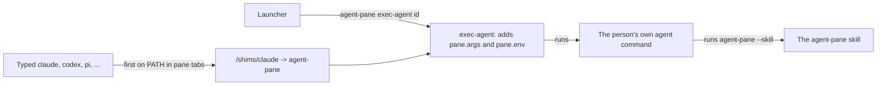

# RFC 0005: Deliver the agent-pane skill to agents in pane tabs

- **Status:** Proposed
- **Issue:** #73
- **Author:** Tessl, for @asakin

## Summary

Every coding agent started in a pane tab, from the launcher or typed in the pane tab's shell, should know it is in Agent Pane and load the `agent-pane` skill with `agent-pane --skill`. Agents run anywhere else should not be told so.

This RFC proposes one mechanism for every agent definition: an **adapter**, saying which arguments and environment variables give that agent a short pane-tab context, applied by one step in the `agent-pane` binary whether the agent was launched or typed. Agent Pane writes nothing into the person's `AGENTS.md` or `CLAUDE.md` files or into any agent's own config.

## Motivation

Today the installer (`write_instructions` in [`scripts/place.sh`](../../scripts/place.sh), `writeInstructions` in [`internal/cmd/place.go`](../../internal/cmd/place.go) on Windows) writes an Agent Pane block into `~/AGENTS.md` and `~/CLAUDE.md`. Those are the person's files, and Agent Pane should not write into them.

An agent in a pane tab also does not know where it is. The skill copies in `~/.agents/skills/` and `~/.claude/skills/` describe the skill, but its description ends "and AGENT_PANE=1 is set", which an agent does not know unless it checks. Today the person fills the gap by hand with **Teach agent**, which types `Run agent-pane --skill and follow what it prints for the rest of this session.` into the pane tab ([README](../../README.md#agent-skill)).

### Goals

- In a pane tab, every agent Agent Pane ships a definition for, started from the launcher or typed in the shell, knows it is in a pane tab and loads the skill without being told. This holds for every shipped definition, whether `agents/enabled.json` turns it on by default or a person turns it on in `config.json`.
- Outside a pane tab, nothing changes for any agent.
- Nothing is written into the person's `AGENTS.md` or `CLAUDE.md` files or into any agent's own config.
- `agent-pane doctor` and `scripts/install_test.sh` cover whatever the installer writes.

## Guide-level explanation

### For a person using Agent Pane

An agent started in a pane tab knows where it is, whether it was picked in the launcher or typed in the shell. Asked about the page, it reads the Chrome tab beside it with the `agent-pane page` read that suits the ask, as the skill describes, instead of asking for a paste. **Teach agent** stays for an agent that misses it, such as one run by an absolute path.

In a pane tab, `command -v claude` names Agent Pane's shims folder. The shim runs the person's own `claude`, the first one on `PATH` after the shims folder, with Agent Pane's arguments added before the person's.

An agent run in another terminal is not affected: the shims folder is not on its `PATH`.

### For a coding agent in a pane tab

When the session starts, the agent receives a short context, in its system or developer prompt, as an always-applied rule, or, for Goose, as a note on each turn:

> This session runs in an Agent Pane pane tab, beside the Chrome tab the person is viewing. Before you answer anything about that page or tab, or hand work to a helper agent, run `agent-pane --skill` and follow what it prints.

Everything else, which page reads exist and when to use each, is in the skill, so a change to what Agent Pane can do reaches agents through the skill alone, with no change to the adapters.

## Reference-level explanation

### One mechanism

Agent Pane already decides the command line of every agent it launches, and the environment of every process in a pane tab. The design uses both, in one place:

- each agent definition says, as data, how that agent is given the context;
- one step in the `agent-pane` binary applies it;
- the launcher, and a typed command through a shim, both reach that step.

Nothing runs outside a pane tab: the shims folder is on `PATH` only there, and the step adds nothing unless `AGENT_PANE=1`. Because the adapter is applied each time the agent starts, it does not depend on whether an agent's config folder existed when Agent Pane was installed.

### Adapters in agent definitions

`agent.json` gains an optional `pane` object:

| Field | Meaning |
| --- | --- |
| `args` | Arguments added before the person's own, in a pane tab only |
| `env` | Variables added in a pane tab only |
| `yield` | Conditions under which the adapter is skipped, because the person has set the same thing for their own reasons |

Values may use four placeholders, filled in by `exec-agent`: `{context}`, the path of `<data>/integrations/context.md`; `{contextText}`, its text; `{contextTOML}`, its text as a TOML string; and `{data}`, Agent Pane's data folder (`~/.local/share/agent-pane`, `%LOCALAPPDATA%\agent-pane` on Windows). A `yield` condition is either `{"env": "<name>"}`, true when that variable is already set, or `{"toml": "<file>", "key": "<key>"}`, true when that file sets that key at the top level. A definition without `pane`, including a person's own definition in `~/.config/agent-pane/agents/`, runs as today.

The shipped adapters:

| Agent | `pane` | Evidence |
| --- | --- | --- |
| Claude Code | `args`: `--append-system-prompt`, `{contextText}` | Tried with 2.1.290: the text reached the model. When the flag is given twice the later one wins (tried), so a person's own `--append-system-prompt` replaces Agent Pane's |
| Codex | `args`: `-c`, `developer_instructions={contextTOML}`; `yield`: `developer_instructions` in `$CODEX_HOME/config.toml` (default `~/.codex/config.toml`) | Tried with 0.155.1 and `codex debug prompt-input`: the text is in the model input. It replaces a `developer_instructions` the person set in `config.toml` (tried), hence the `yield` |
| Pi | `args`: `--append-system-prompt`, `{context}` | Docs only: `--append-system-prompt <text\|path>` "appends text or an existing file to the system prompt" ([CLI docs](https://github.com/earendil-works/pi/blob/main/packages/coding-agent/docs/cli.md)) |
| OpenCode | `env`: `OPENCODE_CONFIG_CONTENT={"instructions":["{context}"]}`; `yield`: `OPENCODE_CONFIG_CONTENT` | Tried with 1.19.6; see [OpenCode](#opencode) |
| Goose | `env`: `GOOSE_MOIM_MESSAGE_FILE={data}/integrations/goose/turn.md`; `yield`: `GOOSE_MOIM_MESSAGE_FILE` | Tried with 1.61.1; see [Goose](#goose) |
| Cursor CLI | `args`: `--plugin-dir`, `{data}/integrations/cursor` | Docs only; see [Cursor](#cursor) |

#### OpenCode

OpenCode has no prompt flag. `OPENCODE_CONFIG_CONTENT` is merged last, and its `instructions` array is concatenated with the person's and de-duplicated, not replaced (tried with 1.19.6; `mergeConfigConcatArrays` in [`config.ts`](https://github.com/anomalyco/opencode/blob/v1.19.6/packages/opencode/src/config/config.ts)).

#### Goose

The built-in "tom" extension, on by default, appends `GOOSE_MOIM_MESSAGE_FILE`'s text to each user turn inside a `<turn-context>` block (tried with 1.61.1; [`tom.rs`](https://github.com/aaif-goose/goose/blob/v1.61.1/crates/goose/src/agents/platform_extensions/tom.rs)). Because it repeats every turn, `turn.md` is one line: this session runs in an Agent Pane pane tab, and `agent-pane --skill` prints how to read the Chrome tab beside it.

#### Cursor

Cursor's CLI has no prompt flag or variable ([parameters](https://cursor.com/docs/cli/reference/parameters)), but `--plugin-dir <path>` loads a local plugin folder. `<data>/integrations/cursor/` is such a plugin: `.cursor-plugin/plugin.json` naming it, and `rules/agent-pane.mdc` holding the context with `alwaysApply: true` ([plugins reference](https://cursor.com/docs/reference/plugins)). Cursor could not be run here without an account, so the implementation verifies that the rule reaches the model, as [Rollout](#rollout) says.

### The exec-agent step

`agent-pane exec-agent <id> [args...]` (name illustrative):

1. Loads the definition `<id>` from the catalog, as the launcher does.
2. Finds its `command` on `PATH`, skipping the shims folder, so it never finds itself. When nothing is found it prints the shell's usual "command not found" message and exits 127.
3. When `AGENT_PANE=1` and no `yield` condition holds, adds `pane.env`, then runs the command with `pane.args` followed by `args`. Otherwise it runs the command with `args` alone. It never adds the definition's top-level `args`: whoever starts the step passes the arguments it wants.
4. On Unix it replaces itself with the command (`execve`), so signals, exit status and the terminal go straight to the agent. On Windows, which has no `exec`, it starts the command, waits, and exits with its status.

The binary started under another name than `agent-pane` (`agent-pane.exe` on Windows) acts as `exec-agent` for the enabled definition whose `command` is that name. That is how a shim works: it is a link to the binary, not a script, so there is no quoting layer between the person's arguments and the agent.

The launcher, in `buildTerminalCommand` in [`internal/cmd/serve.go`](../../internal/cmd/serve.go), starts `agent-pane exec-agent <id>` by the binary's absolute path, through the login shell as today, instead of the agent's command. It passes the definition's top-level `args` followed by the invocation's, as it passes the agent today, so a launched agent gets `pane.args`, then the definition's `args`, then the invocation's, and a definition without `pane` gets exactly today's command line. A typed command through a shim passes only what the person typed, so the definition's `args` stay launcher defaults. Because the definition's and the person's arguments come after `pane.args`, an agent that lets a later flag win, such as Claude Code's `--append-system-prompt`, keeps theirs.

### The shims folder

The installer writes `<data>/shims/` with one entry per enabled definition that has a `pane` object, named after its `command`: a symlink to the installed binary on Unix, and a hard link named `<command>.exe` on Windows (a copy when the link fails). It is rebuilt on every install and when `config.json` changes which agents are on, so a person who turns on Cursor gets its shim, and the folder holds only Agent Pane's links.

`sessionEnv` in [`internal/cmd/env.go`](../../internal/cmd/env.go), for the Built-in and Durable backends alike, and `helperEnv` in [`internal/cmd/team.go`](../../internal/cmd/team.go) put `<data>/shims` at the front of `PATH`, removing any earlier copy of it, when the folder exists. A helper started with `agent-pane run -- claude ...` therefore gets the adapter too.

A login shell's startup files run after that, and can put other folders in front: macOS `path_helper` in `/etc/zprofile` and `/etc/profile` reorders `PATH`, and Homebrew's `shellenv` and many installers prepend their own folder. So pane tabs start zsh, bash and fish with a short Agent Pane startup file that runs the person's own files as usual, then moves `<data>/shims` to the front again:

| Shell | How the startup file is reached |
| --- | --- |
| zsh | `ZDOTDIR` points at `<data>/shell/zsh`, whose `.zshenv`, `.zprofile`, `.zshrc` and `.zlogin` restore the person's `ZDOTDIR` and source the matching file from it |
| bash | `bash --init-file <data>/shell/bash.sh`, which sources `/etc/profile` and the first of `~/.bash_profile`, `~/.bash_login` and `~/.profile`, as a login bash does |
| fish | `fish -l -C 'fish_add_path --global --move --path <data>/shims'`, run after the person's config |

Other shells, and a `command` the person set in `config.json`, get the `PATH` from `sessionEnv` alone. PowerShell and `cmd.exe` on Windows have no login profile that sets `PATH`, so the front position holds there.

Shims are links on `PATH` rather than shell aliases so that one mechanism works in every shell and for scripts, `exec` and helpers, which do not see aliases.

### Agent coverage

| Agent | Context in a pane tab | Needs from the person |
| --- | --- | --- |
| Claude Code | `--append-system-prompt` | Nothing |
| Codex | `-c developer_instructions=` | Nothing, unless `config.toml` sets `developer_instructions` |
| Pi | `--append-system-prompt` with the file | Nothing |
| OpenCode | `instructions` via `OPENCODE_CONFIG_CONTENT` | Nothing |
| Goose | Per-turn note via `GOOSE_MOIM_MESSAGE_FILE` | Nothing |
| Cursor CLI | Always-applied rule via `--plugin-dir` | Nothing |

Where an agent gets no context (a `yield` that holds, an agent run by absolute path, a shell whose startup files move `PATH` and that has no Agent Pane startup file), the skill copies in `~/.agents/skills/` and `~/.claude/skills/`, which stay as today, can still be selected by the skill's description, and **Teach agent** remains the manual fallback.

### Installer changes

`place.sh` and `place.go` change together:

1. `write_instructions` and `writeInstructions` are removed. The installer stops writing `~/AGENTS.md`, `~/CLAUDE.md` and `~/.config/agent-pane/AGENTS.md`.
2. A new step writes `<data>/integrations/` (`context.md`, from `scripts/instructions.md` rewritten as the context above; `goose/turn.md`; and the `cursor/` plugin) and the shell startup files under `<data>/shell/` from the release, and rebuilds `<data>/shims/`.

### Doctor and tests

`agent-pane doctor` replaces its instructions checks in [`internal/cmd/doctor.go`](../../internal/cmd/doctor.go) with:

| Check | Fails when |
| --- | --- |
| `integrations` | `<data>/integrations` or `<data>/shell` differs from the release |
| `shims` | An entry is missing, extra, or does not point at the installed binary |

Its help text and the README stop mentioning `~/AGENTS.md` and `~/CLAUDE.md`, and [agents/README.md](../../agents/README.md) documents `pane`. `scripts/install_test.sh` replaces its block assertions with: `~/AGENTS.md` and `~/CLAUDE.md` are not written, and the new files and shims are written and refreshed. `internal/cmd` tests cover: loading `pane`; `exec-agent` adding the adapter only with `AGENT_PANE=1`, the launcher's command line keeping the definition's `args` before the invocation's, a shim passing only the typed arguments, skipping itself on `PATH`, each `yield` kind, and the shim name dispatch; the shims folder at the front of `PATH` in `sessionEnv` and `helperEnv`; and, for zsh, bash and fish, that a startup file which prepends a folder leaves the shims folder first.

## Drawbacks

- Each adapter follows its agent's command-line flags, which can change, and `doctor` cannot see them break.
- In a pane tab `claude` and the other adapted names resolve to Agent Pane's shims, which a person running `which claude` may not expect.
- Pane tabs that start zsh, bash or fish gain an Agent Pane startup file in front of the person's own. A mistake there would break the pane tab's shell, so it is kept to sourcing the person's files and one `PATH` change, and is tested per shell.
- Codex's adapter yields to a `developer_instructions` the person set, so such a person gets no context in a pane tab. A value set only in a Codex profile is not seen and is replaced for that run.
- Goose spends a few tokens on each turn in a pane tab.

## Rationale and alternatives

The context only points at `agent-pane --skill` rather than repeating the skill's instructions, so the skill stays the one place that says how to use Agent Pane.

## Rollout

Before merging, the implementation pull request records, for each shipped agent at its current version, the answer to "how do I read the page next to me?" in a pane tab (launched and typed, in zsh, bash and fish, on macOS with `path_helper`) and in another terminal. This includes the two adapters known from docs only: Pi's `--append-system-prompt` with a file, and Cursor's `--plugin-dir` rule.
