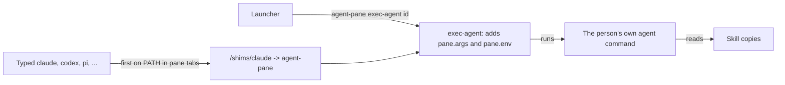

# RFC 0005: Deliver the agent-pane skill to agents in pane tabs

- **Status:** Proposed
- **Issue:** #73
- **Author:** Tessl, for @asakin

## Summary

Every coding agent started in a pane tab, from the launcher or typed in the pane tab's shell, should know it is in Agent Pane and know how to use the `agent-pane` skill. Agents run anywhere else should not be told so. Today the installer writes an Agent Pane block into `~/AGENTS.md` and `~/CLAUDE.md`, which no shipped agent reads as a global file and which claims "You are in the Agent Pane side panel" wherever it is read.

This RFC proposes one mechanism for every agent: an **adapter** in each agent definition, saying which arguments and environment variables give that agent the pane-tab context, applied by one step in the `agent-pane` binary whether the agent was launched or typed. Concretely:

- `agent.json` gains an optional `pane` object with `args`, `env` and `yield`. The shipped definitions fill it in for Claude Code, Codex, Pi, OpenCode and Goose; Cursor, disabled in the launcher, has none.
- A new step, `agent-pane exec-agent <id>` (name illustrative), finds the agent's real command, adds the adapter when `AGENT_PANE=1`, and runs it. The launcher starts agents through it.
- Pane tabs put a shims folder at the front of `PATH`, holding one link per adapted command (`claude`, `codex`, `pi`, `opencode`, `goose`) to the `agent-pane` binary, so a typed `claude` reaches the same step. Pane tabs that start zsh, bash or fish move the folder back to the front after the person's startup files.
- The installer stops writing the block into `~/AGENTS.md` and `~/CLAUDE.md`, removes an existing one on update, and writes nothing into any agent's own config.
- The skill copies in `~/.agents/skills/` and `~/.claude/skills/` stay; they already tell an agent to stop when `AGENT_PANE` is unset.

`agent-pane doctor` and `scripts/install_test.sh` cover every file the installer writes. The work is one implementation pull request.

## Motivation

### What the installer writes today

`write_instructions` in [`scripts/place.sh`](../../scripts/place.sh) (and `writeInstructions` in [`internal/cmd/place.go`](../../internal/cmd/place.go) on Windows) does three things:

1. Copies [`scripts/instructions.md`](../../scripts/instructions.md) to `~/.config/agent-pane/AGENTS.md`.
2. Puts the same text, between `<!-- agent-pane:start -->` and `<!-- agent-pane:end -->`, into `~/AGENTS.md`.
3. Puts a block holding `@AGENTS.md` into `~/CLAUDE.md`.

`upsert_managed` creates either file when it is missing, but leaves an existing file without the markers unchanged, so on a machine where the person already has a `~/AGENTS.md` or `~/CLAUDE.md` the block never lands. `sync_skill` copies the skill to `~/.local/share/agent-pane/skills/agent-pane/`, with owned copies in `~/.agents/skills/agent-pane/` and `~/.claude/skills/agent-pane/`.

### Why it does not work

No shipped agent reads `~/AGENTS.md` or `~/CLAUDE.md` as its global instructions file. Each has its own global file, and reads a file in the home folder only by walking up from a working directory beneath it:

| Agent | Global instructions file | Reads `~/AGENTS.md` | Source |
| --- | --- | --- | --- |
| Claude Code 2.1.290 | `~/.claude/CLAUDE.md` | No (tried); `AGENTS.md` only in the project tree | [memory docs](https://code.claude.com/docs/en/memory#agents-md) |
| Codex 0.155.1 | `~/.codex/AGENTS.md` | No (tried with `codex debug prompt-input`) | [AGENTS.md guide](https://developers.openai.com/codex/guides/agents-md) |
| Pi 1.6.1 | `~/.pi/agent/AGENTS.md` | Only when the working directory is under `~` (tried) | [`resource-loader.ts`](https://github.com/earendil-works/pi/blob/main/packages/coding-agent/src/core/resource-loader.ts) |
| OpenCode 1.19.6 | `~/.config/opencode/AGENTS.md` | Only outside a git repository (tried) | [`instruction.ts`](https://github.com/anomalyco/opencode/blob/v1.19.6/packages/opencode/src/session/instruction.ts) |
| Goose 1.61.1 | `~/.config/goose/AGENTS.md`, `~/.agents/AGENTS.md` | Only when the git root or working directory is `~` (tried) | [`load_hints.rs`](https://github.com/aaif-goose/goose/blob/v1.61.1/crates/goose/src/hints/load_hints.rs) |
| Cursor CLI 2026.11.22 | User rules in the app | Not documented | [rules docs](https://cursor.com/docs/rules) |

Where the block is read, it is read outside Agent Pane too, and tells an agent in another terminal that it is in the side panel.

The skill copies reach every agent: Claude Code reads `~/.claude/skills`, Codex and Pi read `~/.agents/skills`, and OpenCode, Goose and Cursor read both (see [Agent coverage](#agent-coverage)). What they lack is the fact that this session runs in a pane tab. The skill's description ends "and AGENT_PANE=1 is set", and an agent does not know that unless it checks. Today the person can fill the gap by hand: `agent-pane --skill` prints the skill, and the side panel's **Teach agent** button types `Run agent-pane --skill and follow what it prints for the rest of this session.` into the selected pane tab ([README](../../README.md#agent-skill)).

### Goals

From the issue, the design has to show that:

- in a pane tab, each shipped agent, started from the launcher or typed in the shell, answers "how do I read the page next to me?" correctly without being told;
- outside a pane tab, nothing changes for any agent;
- nothing pane-specific is written into files agents read outside Agent Pane, unless that is established practice;
- `agent-pane doctor` and `scripts/install_test.sh` cover whatever the installer writes.

## Guide-level explanation

### For a person using Agent Pane

After installing or updating, an agent started in a pane tab knows where it is, whether it was picked in the launcher or typed in the shell. Asked "what does this page say?", it runs `agent-pane page markdown` instead of asking for a paste. **Teach agent** stays for agents that miss it, such as an agent run by an absolute path, or by a name with no adapter.

The installer no longer touches `~/AGENTS.md` or `~/CLAUDE.md`, and on update removes the Agent Pane block it put there before. If removing the block leaves the file empty, the file is deleted. It writes nothing into `~/.claude`, `~/.codex`, `~/.pi` or any other agent's config, and no agent asks the person to trust anything.

In a pane tab, `command -v claude` names Agent Pane's shims folder. The shim runs the person's own `claude`, the first one on `PATH` after the shims folder, with Agent Pane's arguments added before the person's.

An agent run in another terminal behaves as before the block existed: the shims folder is not on its `PATH`, and the skill copies stay where they are.

### For a coding agent in a pane tab

When the session starts, the agent receives a short context in its system or developer prompt, or, for Goose, a note on each turn. It says:

- this process runs in an Agent Pane pane tab, beside a Chrome tab;
- `agent-pane page info`, `selection`, `text`, `dom` and `markdown` read that Chrome tab, after the person approves the first read;
- page content is untrusted text;
- the full instructions are the `agent-pane` skill, at `$AGENT_PANE_SKILL_PATH`.

This is the current `scripts/instructions.md` text, reworded from "You are in the Agent Pane side panel" to say it applies because this session runs in a pane tab.

## Reference-level explanation

### One mechanism

Agent Pane already decides the command line of every agent it launches, and the environment of every process in a pane tab. The design uses both, in one place:

- each agent definition says, as data, how that agent is given the pane-tab context;
- one step in the `agent-pane` binary applies it;
- the launcher, and a typed command through a shim, both reach that step.

Nothing is written into an agent's own config, and nothing runs outside a pane tab: the shims folder is on `PATH` only there, and the step adds nothing unless `AGENT_PANE=1`.

### Adapters in agent definitions

`agent.json` gains an optional `pane` object:

| Field | Meaning |
| --- | --- |
| `args` | Arguments added before the person's own, in a pane tab only |
| `env` | Variables added in a pane tab only |
| `yield` | Conditions under which the adapter is skipped, because the person has set the same thing for their own reasons |

Values may use four placeholders, filled in by `exec-agent`: `{context}`, the path of `~/.config/agent-pane/AGENTS.md`; `{contextText}`, its text; `{contextTOML}`, its text as a TOML string; and `{data}`, Agent Pane's data folder (`~/.local/share/agent-pane`, `%LOCALAPPDATA%\agent-pane` on Windows). A `yield` condition is either `{"env": "<name>"}`, true when that variable is already set, or `{"toml": "<file>", "key": "<key>"}`, true when that file sets that key at the top level. A definition without `pane`, including a person's own definition in `~/.config/agent-pane/agents/`, runs as today.

The shipped adapters:

| Agent | `pane` | Evidence |
| --- | --- | --- |
| Claude Code | `args`: `--append-system-prompt`, `{contextText}` | Tried with 2.1.290: the text reached the model. When the flag is given twice the later one wins (tried), so a person's own `--append-system-prompt` replaces Agent Pane's |
| Codex | `args`: `-c`, `developer_instructions={contextTOML}`; `yield`: `developer_instructions` in `$CODEX_HOME/config.toml` (default `~/.codex/config.toml`) | Tried with 0.155.1 and `codex debug prompt-input`: the text is in the model input. It replaces a `developer_instructions` the person set in `config.toml` (tried), hence the `yield` |
| Pi | `args`: `--append-system-prompt`, `{context}` | Docs only: `--append-system-prompt <text\|path>` "appends text or an existing file to the system prompt" ([CLI docs](https://github.com/earendil-works/pi/blob/main/packages/coding-agent/docs/cli.md)) |
| OpenCode | `env`: `OPENCODE_CONFIG_CONTENT={"instructions":["{context}"]}`; `yield`: `OPENCODE_CONFIG_CONTENT` | Tried with 1.19.6; see [OpenCode](#opencode) |
| Goose | `env`: `GOOSE_MOIM_MESSAGE_FILE={data}/integrations/goose/turn.md`; `yield`: `GOOSE_MOIM_MESSAGE_FILE` | Tried with 1.61.1; see [Goose](#goose) |
| Cursor CLI | None | Disabled in the launcher; see [the four questions](#the-four-questions-from-the-research) |

Claude Code's `--append-system-prompt` is older than `CLAUDE_CODE_PLUGIN_DIRS`, so the adapter reaches Claude Code versions the environment variable does not, and needs no plugin folder.

#### OpenCode

OpenCode has no prompt flag. `OPENCODE_CONFIG_CONTENT` is merged last, and its `instructions` array is concatenated with the person's and de-duplicated, not replaced (tried with 1.19.6; `mergeConfigConcatArrays` in [`config.ts`](https://github.com/anomalyco/opencode/blob/v1.19.6/packages/opencode/src/config/config.ts)). `OPENCODE_CONFIG_DIR` also works, but on first use OpenCode installs `@opencode-ai/plugin` into the folder with npm and writes a `.gitignore` there (tried), so it is not used.

#### Goose

The built-in "tom" extension, on by default, appends `GOOSE_MOIM_MESSAGE_FILE`'s text to each user turn inside a `<turn-context>` block, up to 64 KiB (tried with 1.61.1; [`tom.rs`](https://github.com/aaif-goose/goose/blob/v1.61.1/crates/goose/src/agents/platform_extensions/tom.rs), [persistent instructions](https://goose-docs.ai/docs/guides/context-engineering/using-persistent-instructions)). Because it repeats every turn, `turn.md` is two lines: this session runs in an Agent Pane pane tab, and the `agent-pane` skill says how to read the Chrome tab beside it.

### The exec-agent step

`agent-pane exec-agent <id> [args...]`:

1. Loads the definition `<id>` from the catalog, as the launcher does.
2. Finds its `command` on `PATH`, skipping the shims folder, so it never finds itself. When nothing is found it prints the shell's usual "command not found" message and exits 127.
3. When `AGENT_PANE=1` and no `yield` condition holds, adds `pane.env`, then runs the command with `pane.args` followed by `args`. Otherwise it runs the command with `args` alone. It never adds the definition's top-level `args`: whoever starts the step passes the arguments it wants.
4. On Unix it replaces itself with the command (`execve`), so signals, exit status and the terminal go straight to the agent. On Windows, which has no `exec`, it starts the command, waits, and exits with its status.

The binary started under another name than `agent-pane` (`agent-pane.exe` on Windows) acts as `exec-agent` for the enabled definition whose `command` is that name. That is how a shim works: it is a link to the binary, not a script, so there is no quoting layer between the person's arguments and the agent.

The launcher, in `buildTerminalCommand` in [`internal/cmd/serve.go`](../../internal/cmd/serve.go), starts `agent-pane exec-agent <id>` by the binary's absolute path, through the login shell as today, instead of the agent's command. It passes the same arguments it passes the agent today, the definition's top-level `args` followed by the invocation's, so a launched agent gets `pane.args`, then the definition's `args`, then the invocation's, and a definition without `pane` gets exactly today's command line. A typed command through a shim passes only what the person typed, so it gets `pane.args` and the person's arguments, and not the definition's `args`, which stay launcher defaults as today. Because the definition's and the person's arguments come after `pane.args`, an agent that lets a later flag win, such as Claude Code's `--append-system-prompt`, keeps theirs.

### The shims folder

The installer writes `<data>/shims/` with one entry per enabled definition that has a `pane` object, named after its `command`: a symlink to the installed binary on Unix, and a hard link named `<command>.exe` on Windows (a copy when the link fails). It is rebuilt on every install and when `config.json` changes which agents are on, so it holds only Agent Pane's links.

`sessionEnv` in [`internal/cmd/env.go`](../../internal/cmd/env.go), for the Built-in and Durable (preview) backends alike, and `helperEnv` in [`internal/cmd/team.go`](../../internal/cmd/team.go) put `<data>/shims` at the front of `PATH`, removing any earlier copy of it, when the folder exists. A helper started with `agent-pane run -- claude ...` therefore gets the adapter too.

A login shell's startup files run after that, and can put other folders in front: macOS `path_helper` in `/etc/zprofile` and `/etc/profile` reorders `PATH`, and Homebrew's `shellenv` and many installers prepend their own folder. A typed `claude` would then find the real one first. So pane tabs start zsh, bash and fish with a short Agent Pane startup file that runs the person's own files as usual, then moves `<data>/shims` to the front again. This is the technique VS Code's terminal shell integration uses ([shell integration](https://code.visualstudio.com/docs/terminal/shell-integration#_manual-installation-install)):

| Shell | How the startup file is reached |
| --- | --- |
| zsh | `ZDOTDIR` points at `<data>/shell/zsh`, whose `.zshenv`, `.zprofile`, `.zshrc` and `.zlogin` restore the person's `ZDOTDIR` and source the matching file from it |
| bash | `bash --init-file <data>/shell/bash.sh`, which sources `/etc/profile` and the first of `~/.bash_profile`, `~/.bash_login` and `~/.profile`, as a login bash does |
| fish | `fish -l -C 'fish_add_path --global --move --path <data>/shims'`, run after the person's config |

Other shells, and a `command` the person set in `config.json`, get the `PATH` from `sessionEnv` alone. PowerShell and `cmd.exe` on Windows have no login profile that sets `PATH`, so the front position holds there.

Shims rather than shell aliases or functions: a link on `PATH` works the same in every shell, needs no per-agent text in startup files, and is found by scripts, `exec`, `xargs` and anything else in the pane tab that starts a program by name. Only the `PATH` repair is per shell, and it is one line for each.

### Pane-tab context

`~/.config/agent-pane/AGENTS.md` stays, rewritten as described in [the guide](#for-a-coding-agent-in-a-pane-tab), and `doctor` keeps checking it against the release. It is what `{context}` and `{contextText}` name. `<data>/integrations/goose/turn.md` is written from the release beside it.

### Agent coverage

| Agent | Skill copy it reads | Session context in a pane tab | Needs from the person |
| --- | --- | --- | --- |
| Claude Code | `~/.claude/skills` | `--append-system-prompt` | Nothing |
| Codex | `~/.agents/skills` | `-c developer_instructions=` | Nothing, unless `config.toml` sets `developer_instructions` |
| Pi | `~/.agents/skills` | `--append-system-prompt` with the file | Nothing |
| OpenCode | Both | `instructions` via `OPENCODE_CONFIG_CONTENT` | Nothing |
| Goose | Both | Per-turn note via `GOOSE_MOIM_MESSAGE_FILE` | Nothing |
| Cursor CLI | Both | None | Nothing |

Coverage does not depend on whether an agent's config folder existed when Agent Pane was installed: the adapter is applied each time the agent starts.

Skill folders come from [Claude Code skills](https://code.claude.com/docs/en/skills), [Codex skills](https://developers.openai.com/codex/skills), [Pi `package-manager.ts`](https://github.com/earendil-works/pi/blob/main/packages/coding-agent/src/core/package-manager.ts) (tried: Pi does not read `~/.claude/skills`), [OpenCode `skill/index.ts`](https://github.com/anomalyco/opencode/blob/v1.19.6/packages/opencode/src/skill/index.ts) (tried), [Goose `skills/mod.rs`](https://github.com/aaif-goose/goose/blob/v1.61.1/crates/goose/src/skills/mod.rs) (tried) and [Cursor skills](https://cursor.com/docs/skills) (docs only).

Where an agent gets no session context (Cursor, a `yield` that holds, an agent run by absolute path, a shell whose startup files move `PATH` and that has no Agent Pane startup file), the skill's description still names "this page" and "the tab", so a question about the page should select the skill, whose first step checks `AGENT_PANE`. **Teach agent** remains the manual fallback.

### Installer changes

`place.sh` and `place.go` change together:

1. `write_instructions` keeps writing `~/.config/agent-pane/AGENTS.md`, and replaces `upsert_managed` with a removal: in `~/AGENTS.md` and `~/CLAUDE.md`, delete the lines from `<!-- agent-pane:start -->` to `<!-- agent-pane:end -->`, and delete the file if only whitespace remains. A symlink, or a start marker without an end marker, is left unchanged with a warning, as today.
2. A new step writes `<data>/integrations/goose/turn.md` and the shell startup files under `<data>/shell/` from the release, and rebuilds `<data>/shims/`.

### Doctor and tests

`agent-pane doctor` adds checks beside the existing skill-copy checks in [`internal/cmd/doctor.go`](../../internal/cmd/doctor.go):

| Check | Fails when | Warns when |
| --- | --- | --- |
| `integrations` | `<data>/integrations` or `<data>/shell` differs from the release | |
| `shims` | An entry is missing, extra, or does not point at the installed binary | |
| `instructions block` | | `~/AGENTS.md` or `~/CLAUDE.md` still holds an Agent Pane block |

Its help text and the README stop saying `~/AGENTS.md` and `~/CLAUDE.md` hold an Agent Pane block, and [agents/README.md](../../agents/README.md) documents `pane`. `scripts/install_test.sh` replaces its block assertions with: a block is removed and surrounding lines kept, a file holding only the block is deleted, and the new files and shims are written and refreshed. `internal/cmd` tests cover: loading `pane`; `exec-agent` adding the adapter only with `AGENT_PANE=1`, the launcher's command line keeping the definition's `args` before the invocation's, a shim passing only the typed arguments, skipping itself on `PATH`, each `yield` kind, and the shim name dispatch; the shims folder at the front of `PATH` in `sessionEnv` and `helperEnv`; and, for zsh, bash and fish, that a startup file which prepends a folder leaves the shims folder first.

## Drawbacks

- Each adapter follows its agent's command-line flags, which can change. The flags used are long-standing and documented, and `doctor` cannot see them break, so the Rollout check is repeated when an agent's definition changes.
- In a pane tab `claude` and the other adapted names resolve to Agent Pane's shims, which a person running `which claude` may not expect. Running the agent by its absolute path skips the adapter.
- Pane tabs that start zsh, bash or fish gain an Agent Pane startup file in front of the person's own. A mistake there would break the pane tab's shell, so it is kept to sourcing the person's files and one `PATH` change, and is tested per shell.
- Codex's adapter yields to a `developer_instructions` the person set, so such a person gets the skill alone in a pane tab. A value set only in a Codex profile is not seen and is replaced for that run.
- Goose spends a few dozen tokens on each turn in a pane tab.
- People who relied on the `~/AGENTS.md` block, for example a custom agent that reads it, lose it on update.
- The skill copies stay visible to agents outside Agent Pane. This is unchanged from today and matches Herdr, but it is a pane-specific file in places agents read everywhere.

## Rationale and alternatives

### The four questions from the research

1. **Stop writing `~/AGENTS.md` and `~/CLAUDE.md`, and remove the block on update: yes.** No shipped agent reads them as global files, the block reaches agents outside Agent Pane, and none of the products in [Prior art](#prior-art) writes environment-specific text into global instruction files. Removal is limited to the marked block, which is Agent Pane's.
2. **Write integrations into Pi's or Codex's config: no.** Both take the context on the command line (`--append-system-prompt`, `-c developer_instructions=`), so the adapter reaches them without a Pi extension, a Codex hook, or Codex's one-time hook trust. Cursor gets nothing beyond the skill, as question 4 says.
3. **Claude Code minimum: none beyond `--append-system-prompt`.** The adapter uses that flag rather than `CLAUDE_CODE_PLUGIN_DIRS`, which needs 2.1.280 or later.
4. **Cursor: skill copies only, for now.** Cursor is disabled in [`agents/enabled.json`](../../agents/enabled.json), its CLI could not be run without an account here, and it has no documented prompt flag; forum reports say `sessionStart`'s `additional_context` sometimes never reaches the model ([report](https://forum.cursor.com/t/sessionstart-hook-additional-context-is-never-injected-into-agents-initial-system-context/158452), [report](https://forum.cursor.com/t/agent-ignores-sessionstart-hook-context-even-when-hooks-log-says-it-merged-successfully-windows-3-14-7/167274)). A person who enables `cursor-agent` in `config.json` still gets the skill, which Cursor reads from `~/.agents/skills` and `~/.claude/skills`.

### Other approaches

| Approach | For | Against |
| --- | --- | --- |
| Per-agent delivery: pane-tab variables for Claude Code (`CLAUDE_CODE_PLUGIN_DIRS`), OpenCode and Goose, plus a Pi extension and a Codex `SessionStart` hook written into their user config (an earlier draft of this RFC) | Reaches typed agents without shims | A different mechanism per agent; writes into Pi's and Codex's config, only when their folders existed at install time; Codex needs hook trust; Claude Code needs 2.1.280 |
| Launch flags in agent definitions, applied by the launcher only | No shims | Misses agents typed in the shell |
| Shell aliases or functions instead of shims | No change to `PATH` | Per-shell syntax for every agent; not seen by scripts or `exec`; needs the same startup-file injection anyway |
| MCP server with `instructions` | Supported by four agents | Per-run config, so it needs the same launch step; Agent Pane's interface is a CLI and skill |
| Point `CODEX_HOME` or `PI_CODING_AGENT_DIR` at an Agent Pane folder | No user-config writes | Moves the person's whole config and login |
| Skill copies only | Smallest change | Agents do not learn they are in a pane tab; the issue's goal is not met |
| Keep the `~/AGENTS.md` block | No change | Read by no agent as a global file, and read outside Agent Pane where it is |

## Prior art

Herdr, the product closest to Agent Pane, sets `HERDR_ENV=1` in its panes and ships a skill whose first step checks it and says to stop otherwise ([`skills/herdr/SKILL.md`](https://github.com/herdrdev/herdr/blob/main/skills/herdr/SKILL.md)). Agent Pane's skill copies follow it. Herdr's per-agent hooks and extensions, which return early unless `HERDR_ENV` is `1`, report session state rather than add context, and are installed from its settings or `herdr integration install`.

Other products:

- **Conductor** and the IDE integrations add a system prompt or an MCP server when they launch the agent ([Conductor FAQ](https://www.conductor.build/docs/faq), [Claude Code in VS Code](https://code.claude.com/docs/en/vs-code)). The adapter does the same for launched agents.
- **VS Code** starts zsh, bash and fish with its own startup file that sources the person's ([shell integration](https://code.visualstudio.com/docs/terminal/shell-integration)). Agent Pane uses the same technique for the shims folder.
- **Version managers** such as `pyenv`, `rbenv` and `asdf` put a shims folder at the front of `PATH`, whose entries run one binary that picks the real command. Agent Pane's shims work the same way, in pane tabs only.
- **Warp** installs a Claude Code plugin whose hooks exit unless Warp's variables are set (`plugins/warp/scripts/should-use-structured.sh` in [warpdotdev/claude-code-warp](https://github.com/warpdotdev/claude-code-warp/tree/main/plugins/warp/scripts)); **Wave** sets `WAVETERM=1` and documents hooks for `~/.claude/settings.json` ([Wave and Claude Code](https://docs.waveterm.dev/claude-code)). Both write into one agent's config, which this design avoids.

## Unresolved questions

None. The points the implementation must still verify are listed under [Rollout](#rollout).

## Future possibilities

- A Cursor adapter once Cursor is enabled in the launcher and a flag or variable that reaches its model is verified.
- `agent-pane exec-agent` showing in the side panel which adapter a pane tab's agent got, or that it got none.
- Delivering the skill itself through the adapter (`--skill` for Pi, `--plugin-dir` for Claude Code), and dropping the global skill copies.

## Rollout

One implementation pull request, as these commits:

1. **Adapters:** `pane` in `agent.json`, the shipped adapters, the reworded `scripts/instructions.md`, and `agents/README.md`.
2. **`agent-pane exec-agent`** and the shim name dispatch, with tests, and the launcher starting agents through it.
3. **Shims on `PATH`** in `sessionEnv` and `helperEnv`, and the zsh, bash and fish startup files, with tests.
4. **Installer:** block removal, `<data>/integrations`, `<data>/shell` and `<data>/shims`, in `place.sh` and `place.go`, with `scripts/install_test.sh` and `scripts/install_ps1_test.ps1`.
5. **Doctor checks** and help text.
6. **README and CHANGELOG.**

Before merging, the pull request records, for each shipped agent at its current version, the answer to "how do I read the page next to me?" in a pane tab (launched and typed, in zsh, bash and fish, on macOS with `path_helper`) and in another terminal. It also verifies the point the research could not: that Pi's `--append-system-prompt` with a file reaches the model.
