# RFC 0001: Herdr core as Agent Pane's terminal backend

- **Status:** Proposed
- **Issue:** #16
- **Author:** Tessl, for @asakin

## Summary

Run every pane tab's terminal in a private, pinned copy of [herdr-core](https://github.com/herdrdev/herdr-core) (`hc`) that Agent Pane ships inside its own release, instead of in PTYs the Go native host owns. The extension, the side panel, the native-messaging protocol and the `agent-pane page` trust model stay Agent Pane's. The Go host stops owning PTYs and becomes a bridge: it speaks the existing `tty.*` RPCs and loopback WebSocket to the extension, and herdr-core's JSON-RPC socket to the core. In exchange, pane tabs survive Chrome, extension and host restarts and Agent Pane upgrades. Agents in pane tabs can also report status and start, message and wait on each other, all under Agent Pane's names (`agent-pane run`, `agent-pane send`, `agent-pane wait`). Users never install Herdr or see the word. The first slice is a bridge behind an off-by-default setting, with the current PTY backend kept as the default and the fallback until the checks in [Readiness checks](#readiness-checks) pass.

## Motivation

Today the host process Chrome starts for native messaging (`agent-pane serve`) owns every PTY session: `SessionManager` in `internal/cmd/serve.go` creates the PTY, keeps a 2 MiB scrollback ring (`internal/scrollback`), serves the WebSocket, and reaps the process. On macOS the shell is started by the spawn LaunchAgent (`spawn_darwin.go`) so it outlives Chrome's process group, but the PTY is still held by the host. That has costs users see:

- **Pane tabs end with the host.** Quitting Chrome, a crash of the host, reloading the extension, or installing an update ends every coding agent in every pane tab. The README says so for updates: "On macOS the LaunchAgent restarts, ending the shells open in pane tabs".
- **Agents cannot work together.** A coding agent in one pane tab has no supported way to find another pane tab, send it a task, or wait for it. Users copy text between tabs by hand.
- **No agent status.** The tab strip shows a title, not whether the agent in a tab is working, finished, or waiting on the person.
- **Agent Pane maintains a terminal server.** Scrollback replay, mode restoration, keepalive, reaping and the macOS spawn agent are all Agent Pane code, and each new terminal feature (durability, flow control, remote machines) would be more.

herdr-core is an Apache-2.0 Rust terminal runtime built for coding agents. It keeps terminals in separate holder processes that survive the core restarting or updating. It has a versioned JSON-RPC API (OpenRPC schema, protocol generation 1), parent and child terminals, names and labels, `send`/`wait`/`read`, a status protocol programs can report through, and SSH-backed remote machines. It draws nothing, which suits a product that already has its own UI. Using it lets Agent Pane spend its effort on what only Agent Pane does: the side panel beside the page, page reads with per-pane-tab approvals, and one-click agents.

The outcome this RFC aims for: a person opens Agent Pane, starts Claude Code in a pane tab, quits Chrome, reopens it, and the same session is still there; that agent can start a Codex helper in a new pane tab, hand it a page, and wait for it, and the tab strip shows which of the two is working and which is blocked.

## Guide-level explanation

### For a person using Agent Pane

Nothing new to install. The install command still installs Agent Pane; the release archive carries a pinned `hc` binary that the installer places under `~/.local/share/agent-pane/` and that only Agent Pane uses. A person's own Herdr or herdr-core install, if they have one, is not touched and does not see Agent Pane's terminals.

What changes, once the new backend is the default:

- **Pane tabs last.** Closing Chrome, reloading the extension, or updating Agent Pane leaves coding agents running. Reopening the side panel in that Chrome window brings back its pane tabs with their screens. A reboot ends the programs; pane tabs then come back as a shell in the same folder.
- **Status in the tab strip.** A pane tab shows a small status mark when its coding agent reports one: working, blocked (waiting on you, with the reason when given), done, or error. A blocked pane tab in the background draws attention.
- **Closing a pane tab ends it.** The close button ends the terminal as it does today. Closing the Chrome window keeps its pane tabs, which the next side panel in a window can reopen from a "Running pane tabs" list. This is a deliberate change from today, where closing the window ends them; see [Close and destroy](#close-and-destroy).
- **Agents can open helper pane tabs.** When a coding agent runs `agent-pane run --tab codex "review this diff"`, a new pane tab appears beside it in the same Chrome window running the helper.

### For a coding agent in a pane tab

The Agent Pane skill (`skills/agent-pane/SKILL.md`) grows a section on teamwork, with Agent Pane commands that wrap the core:

```sh
agent-pane ls                                  # pane tabs and helpers, with status
agent-pane run --bg --name review codex "review src/x.go; report with: agent-pane send $AGENT_PANE_TAB_ID done"
agent-pane send review "also check the tests"
agent-pane wait review                         # until it reports done, blocked or exits
agent-pane read --lines 60 review
agent-pane status working "running tests"      # report this agent's own status
```

`agent-pane page` works as before. A helper started from a pane tab is part of that pane tab for page reads (see [Page reads](#page-reads-environment-and-peer-checks)), so it can read the page only through the pane tab's approval.

### For a contributor

The extension and its tests change little. The Go host gains a `backend` interface with two implementations, `ptyBackend` (today's `SessionManager`) and `coreBackend`, and a small client for herdr-core's socket protocol. `agent-pane doctor` gains checks for the bundled core. New tests run a real pinned `hc` in a temporary `HOME`.

## Reference-level explanation

### Target architecture

```mermaid
flowchart LR
  ext["Extension<br/>(background + side panel, xterm.js)"]
  host["agent-pane serve<br/>(native-messaging bridge)"]
  core["bundled hc core<br/>(HC_SESSION=agent-pane)"]
  holder["hc holders<br/>(own the PTYs)"]
  term["Terminal process<br/>(shell, coding agent)"]
  cli["agent-pane CLI<br/>(page, run, send, wait)"]
  broker["agent-pane page broker<br/>(page sockets, grants)"]

  ext <-- "native messaging: tty.*, config.*, page requests" --> host
  ext <-- "loopback WebSocket: origin + one-time token" --> host
  host <-- "unix socket: JSON-RPC + framed channels" --> core
  core --- holder --- term
  term -- "runs" --> cli
  cli -- "page reads: per-session socket, peer checked" --> broker
  broker <-- "in-process" --> host
  cli -- "run/send/wait: core socket" --> core
```



Responsibilities:

| Part | Keeps | Gains | Loses |
| --- | --- | --- | --- |
| Extension | xterm.js, tab strip, launcher, page reading, approval prompts, `tty.*` client | Status marks, "Running pane tabs" list, helper tabs appearing | Nothing |
| Go host (`agent-pane serve`) | Native messaging, version/protocol check, WebSocket origin and token checks, pane-tab registry and page grants, page sockets and peer checks, config, agent catalog, themes | A herdr-core client; mapping pane tab to core terminal; event subscription | PTY creation, scrollback ring, reaping, macOS spawn handoff (in core mode) |
| Bundled core | | PTYs, durability, replay, resize arbitration, flow control, status, parent and child, send/wait/read | |
| `agent-pane` CLI | `page`, `doctor`, `serve` | `ls`, `run`, `send`, `wait`, `read`, `status` | |

The host remains the only thing the extension talks to. The extension never connects to the core, and no Chrome permission changes.

### Extension-facing RPCs

Keep `tty.create`, `tty.attach`, `tty.resize`, `tty.list` and `tty.destroy` and their WebSocket contract stable; the host translates. Reasons: the extension's input gating depends on "one binary replay frame first" (`ptyAttach.ts`), the verifier `pty-websocket-origin-token` and the tests in `serve_ws_test.go` pin the attach boundary, and an unchanged extension can run against either backend, which is what makes a fallback cheap.

Mapping:

| RPC | `ptyBackend` (today) | `coreBackend` |
| --- | --- | --- |
| `tty.create` | new PTY, new session id | `terminal.run` with argv, cwd, env, size and labels (below); returns the host's session id, mapped to the core terminal |
| `tty.attach` | token for the session's WebSocket | same token; on WebSocket open the host calls `terminal.attach {history}` and forwards frames |
| `tty.resize` | `Pty.Resize` | RESIZE frame on the attach channel |
| `tty.list` | live sessions | live core terminals labelled with this install's pane tabs |
| `tty.destroy` | kill and reap | `terminal.kill` then `terminal.rm`; with `pane`, revoke grants |

Additions, all optional so an older extension keeps working, raising `protocolVersion` only when the extension starts relying on them:

- `tty.list` results gain `pane`, `title`, `status` and `window` (the `browserId`/window the pane tab was last shown in) so a side panel can rediscover pane tabs it does not have in `storage.session`.
- A host-to-extension notification `tty.event` carries status, title and exit changes and "a helper pane tab was created for pane tab X" from the core's `events.subscribe` stream.
- `tty.create` accepts `detachOnWindowClose` (see below).

The session id the extension sees stays a host-made opaque id, not the core's `t7` address, so the core's addressing never leaks into extension storage and the `ptyBackend` and `coreBackend` ids cannot be confused.

### Pane-tab identity

A pane tab maps to one live core terminal at a time, recorded on the core terminal itself so it survives the host:

- **Labels on the core terminal:** `agent-pane.pane=<public pane id>`, `agent-pane.session=<public session id>`, `agent-pane.agent=<definition id>`, `agent-pane.window=<browserId>:<windowId>` (updated on attach). Public ids are the hashed forms already given to programs (`publicID` in `pane.go`); the secret pane id stays in host memory and in a host-private file (below), never in core labels, which any same-user process can read.
- **Name:** `ap-<short pane id>` so `agent-pane` commands and the core accept a stable handle, plus an optional user or agent-chosen alias that `agent-pane send <alias>` resolves.
- **Host-private registry:** `~/.local/share/agent-pane/state/panes.json` (0600) maps secret pane id to public pane id, its grants (only if grant persistence is accepted, see [Unresolved questions](#unresolved-questions)), and the current core terminal. It lets a new host process re-establish which secret pane id belongs to a terminal it finds by label.

Rediscovery after restart: a new host lists core terminals with `agent-pane.pane` labels, joins them to `panes.json`, and answers `tty.list` with them. The side panel reattaches the ones in its `storage.session` window state, and offers the rest in the "Running pane tabs" list. A core terminal without a registry entry (registry lost) is listed as an orphan the person can adopt into a new pane tab with no grants, or end.

### Close and destroy

| Action | Today | Proposed (core mode) |
| --- | --- | --- |
| Close a pane tab | Ends the session, revokes grants | Same |
| Close the side panel | Sessions keep running | Same |
| Close the Chrome window | Ends its sessions, revokes grants | Pane tabs detach and keep running; grants are revoked (they are tied to a Chrome tab id that is gone) |
| Quit Chrome / host exits | Ends all sessions | Pane tabs keep running; grants revoked |
| Extension reload or update | Ends all sessions | Pane tabs keep running |
| Agent Pane upgrade | Restarts LaunchAgent, ends sessions on macOS | Core updates in place via its holders; pane tabs keep running |
| Reboot | Ends all sessions | Programs end; terminals started with `--keep` come back as a shell in the last cwd |
| Program exits | Pane tab shows exit; panel offers a replacement | Same; the core terminal is removed once the pane tab replaces or closes it |

Pane tabs are started with `--keep` so a reboot brings back a shell rather than nothing, matching today's "replacement session joins the pane tab" behavior. Helpers an agent starts are not kept unless asked.

Revoking grants when a window closes keeps today's rule that approval belongs to a pane tab shown in a Chrome window, and avoids a durable pane tab silently reading pages in a window opened days later.

### Agent collaboration

All core features are reached through `agent-pane` subcommands that talk to the bundled core's socket with `HC_SESSION=agent-pane` and the private paths set, so they never touch a user's own Herdr. They print Agent Pane terms (pane tab, helper) and Agent Pane ids, and resolve names among this install's terminals only.

- **Helpers.** `agent-pane run` inside a pane tab calls `terminal.run` with `parent` set to the caller's core terminal (from `HC_TERMINAL_ID`, which the core injects) and labels `agent-pane.parent-pane=<public pane id>`. Without `--tab` the helper is a hidden child, visible in `agent-pane ls` and in a pane tab's "Helpers" menu. With `--tab` the host creates a pane tab for it in the parent's window, through the `tty.event` notification.
- **Messages and waits.** `send`, `wait`, `read` map to `terminal.send`, `terminal.wait`, `terminal.read`. `send` to a `blocked` terminal refuses unless `--force`, as the core does, so an agent does not answer a permission prompt meant for the person.
- **Status.** Agents report with OSC 7501 (the core's Program Status Protocol). `agent-pane status <state> [msg]` writes that sequence for agents that can run a command but not print escape codes. Agent definitions may later carry a hook to report status for agents that do not; nothing scrapes screens.
- **Scope.** A pane tab's agent can address its own helpers and pane tabs in the same Agent Pane install. Whether it may send to another top-level pane tab (not its helper) is an [unresolved question](#unresolved-questions); the proposal is yes, since any same-user process can already type into the core.

### Bundled core: install, version, license, lifecycle, isolation

- **Ship:** each Agent Pane release pins one herdr-core version, recorded in `scripts/herdr-core.lock` with per-platform URL and SHA-256. Release CI downloads, checks and places `libexec/hc` in each archive. `checksums.txt` covers it like everything else in the archive. `scripts/dev-install.sh` uses the same lock.
- **Place:** `place.sh` installs it as `~/.local/share/agent-pane/libexec/hc`. Never on `PATH`, never at `~/.local/bin/hc`, never via herdr-core's installer.
- **Update:** only by installing an Agent Pane release. The host never runs `hc update`. Because the core's holders keep terminals across a core update, an Agent Pane upgrade restarts the core but not the pane tabs. A release that moves to a new core protocol generation is called out in release notes as ending pane tabs.
- **Isolate:** the host and the `agent-pane` CLI start and reach the core with `HC_SESSION=agent-pane`, `XDG_STATE_HOME=~/.local/share/agent-pane/core/state`, `XDG_CONFIG_HOME=~/.local/share/agent-pane/core/config`, and `HC_SOCKET` under a private 0700 runtime dir. A shipped `config` disables core features Agent Pane does not use (notes typed into parents, if the extension shows them differently). The core's `HC_SESSION`/`HC_TERMINAL_SOCKET` variables inside a terminal point at the private core, so a user's own `hc` run inside a pane tab would reach Agent Pane's core; the host instead unsets them in the terminal env and passes them under `AGENT_PANE_CORE_*` names to `agent-pane` subcommands. Whether that breaks the core's parent tracking is a [prototype question](#what-needs-a-prototype).
- **Start and stop:** the host starts the core on first use (`hc server start` with the private env) and does not stop it when it exits; that is the durability. `agent-pane doctor --fix` and the installer restart it when the binary changed. An uninstall stops it with `hc server stop`.
- **Supervision:** herdr-core runs itself as systemd user services on Linux and a launchd job on macOS. On macOS this replaces the spawn LaunchAgent for core-mode terminals; the spawn agent stays installed for `ptyBackend` until that backend is removed.
- **License:** herdr-core is Apache-2.0; Agent Pane is MIT. Shipping the binary requires including its `LICENSE` and the third-party notices `hc --licenses` prints. Release CI writes them to `licenses/herdr-core/` in the archive. The README's Origins and license section names the bundled component.
- **Doctor:** `agent-pane doctor` checks that `libexec/hc` matches the lock's checksum, `hc --version` matches the pin, the private state and runtime dirs are 0700 and owned by the user, the core answers `hello` with the expected generation, and (warning only) that no `PATH` `hc` shares its socket. `--fix` restores the binary from the release copy and restarts the core.

### What herdr-core replaces, what stays, what needs proof

**Replaced in core mode:** PTY creation and `startPty`, the scrollback ring and DEC mode replay (`internal/scrollback`), reaping, keepalive of the program, the macOS spawn handoff for terminals.

**Stays in the host:** native messaging and its framing (`internal/jsonrpc`); version and protocol checks; WebSocket origin check and one-time attach tokens; the pane-tab registry and page grants (`pane.go`); the page channel broker, page sockets and peer-credential checks (`page_unix.go`, `internal/peercred`); blocked domains; config, themes and the agent catalog; installer and doctor.

#### What needs a prototype

1. The core's first-paint replay feeds xterm.js correctly, including alt screen, mouse modes, and DA queries, through the existing "first frame is replay" gate.
2. Peer checks for page sockets work with the pid the core reports for a terminal (below).
3. Latency and throughput of WebSocket to host to core to holder compared with today, with a fast-output program (`yes`, a large `cat`).
4. Durability across: Chrome quit, extension reload, host kill, Agent Pane upgrade (core binary replaced), and on macOS across logout/login.
5. Environment control: unsetting `HC_*` in a terminal while keeping parent and child relations for `agent-pane run`.
6. Two Agent Pane cores (two OS users, or a dev install beside a release) and a user's own herdr-core running at once without interference.

### Page reads, environment and peer checks

Today each PTY session gets a socketpair end as fd 3 (`AGENT_PANE_FD`) and a per-session socket (`AGENT_PANE_SOCKET`) that admits only the session's root process and its descendants (`servePageSocket`). herdr-core's `terminal.run` has no way to pass an extra descriptor, and the program's parent is a core holder, not the host.

Proposal for core mode:

- **No inherited descriptor.** `AGENT_PANE_FD` is unset. `agent-pane page` already falls back to `AGENT_PANE_SOCKET`; that becomes the only path.
- **Per-session socket stays in the host.** The host makes it before `terminal.run`, passes its path in `env`, and admits a connection when its peer has the host's uid and descends from the terminal's root process. The root pid comes from `terminal.get` (the core reports process ids), read after `terminal.run` returns and before the socket is served, exactly as the macOS spawn agent's pid is used today.
- **Socket lifetime outlives the host.** Today the socket goes away with the host. With durable terminals it must survive a host restart, so the socket is served by a small long-lived `agent-pane` page broker started alongside the core (or by the host when it is up, refusing reads with "open the Agent Pane side panel" when no extension is connected, as today). Which of the two is an [unresolved question](#unresolved-questions).
- **Helpers.** A helper started with `agent-pane run` gets its own session socket tied to the parent's pane tab, so its reads use the pane tab's approval and its descendants are checked against its own root pid.
- **Environment.** `AGENT_PANE`, `TERM_PROGRAM`, `AGENT_PANE_TAB_ID`, `AGENT_PANE_SESSION_ID`, `AGENT_PANE_AGENT`, `AGENT_PANE_SOCKET` and `AGENT_PANE_SKILL_PATH` keep their meanings and are passed in `terminal.run`'s `env`. The core adds `HC_TERMINAL_ID`; the README's environment table documents it as an implementation detail (or the host renames it, per the prototype). The reserved-name rules in `env.go` apply as now.
- **Trust.** Nothing changes in who decides a read: the host, from the connection it arrives on. The core's own socket has no authentication (any same-user process can run, type into or read any core terminal), which is the same exposure today's README already lists for same-user processes; the RFC does not treat the core socket as a boundary and keeps every page-read decision in the host.

### Attach, replay, input safety, resize, scrollback, reconnect, status

- **Attach.** The host keeps one core attach channel per open WebSocket. The core's first paint (screen plus `history` lines) becomes the WebSocket's single replay frame; live DATA frames follow as binary messages. Input from the WebSocket goes out as DATA frames. The extension's input gate needs no change.
- **Replay size.** The core sends the current screen plus a requested amount of history rather than a raw byte ring, which removes the "ring wrapped, restore modes" case. Core mode does not carry over today's limits: not the host's 2 MiB ring (`scrollbackBytes` in `serve.go`), and not xterm's default `scrollback` of 1000 rows, which the side panel uses because `xterm.getConfig` does not set it. The host asks the core for the history the core keeps (`history_mb`, 5 MiB by default) rather than a fixed row count, and the side panel's xterm `scrollback` is raised to hold that replay. The exact defaults are an [unresolved question](#unresolved-questions).
- **Resize.** The core's rule is "the last active viewer sets the size". The side panel is the only viewer in normal use; `tty.resize` maps to a RESIZE frame on its channel. `agent-pane attach` from a real terminal (a possible future command) would take over the size while focused, which matches expectations.
- **Flow control.** Today the host has no output queue: `Session.readLoop` writes each PTY chunk to the WebSocket synchronously before it reads more, so a slow side panel blocks the PTY reader and, once the kernel buffer fills, the program's own writes. Only the 2 MiB scrollback ring holds output, and it drops the oldest bytes. In core mode the core's credit window (256 KiB) and "repaint if more than 4 MiB behind" replace that backpressure: a slow viewer no longer stalls the program, and a viewer that falls far behind gets a fresh screen instead of the backlog. The host grants credit as the WebSocket drains.
- **Reconnect.** Unchanged in the extension (`reconnect.ts` backoff). A host restart is now survivable: tokens are reissued by the new host, and the core terminal is still there.
- **Status.** The host subscribes to `events.subscribe` filtered by `agent-pane.pane` labels and forwards `status`, `title` and `finished` as `tty.event`. On `missed` it resends a snapshot.

### Platforms and distribution

- **Platforms.** herdr-core ships Linux and macOS (x86_64, aarch64) and Windows x86_64. Agent Pane ships Linux and macOS today, so there is no gap now. Linux depends on systemd user services for core supervision; a Linux without a user systemd manager (some containers, WSL1, minimal distros) needs testing, and falls back to `ptyBackend`.
- **Chrome Web Store.** The extension package does not change: no new permission, no new host access, no bundled binary in the extension. The store listing and review notes say that the native host runs terminals with a bundled open-source terminal runtime (herdr-core, Apache-2.0), named in the listing's third-party notices. The extension never downloads or runs code.
- **Size.** Archive grows by the `hc` binary (several MB per platform).
- **Supply chain.** Agent Pane pins and checks the core by SHA-256 at build time, and installs only from its own release archive, so herdr-core's own unsigned update manifest is never used.
- **Preview status.** herdr-core is 0.x, protocol generation 1, with an additive-only API guarded by a schema test, but no stated stability policy for the CLI or state files. Agent Pane talks only to the versioned socket API, not the CLI, and pins the version.

### Staged plan

Each stage is shippable and reversible on its own.

1. **Backend seam (no behavior change).** Extract a `backend` interface from `SessionManager` covering create, attach stream, resize, list, destroy and root pid. `ptyBackend` is today's code. Tests: existing suites unchanged and passing.
2. **Smallest safe slice: core bridge behind a setting.** Add `coreBackend` and a Go client for the core's framed protocol, the pinned `hc` in dev installs and release archives, and an Options setting **Terminal backend: Built-in (default) | Durable (preview)**. In this slice: `tty.*` mapping, attach and replay through the existing WebSocket, per-session page sockets checked against the core-reported pid, labels and `panes.json`, doctor checks. Not in this slice: status marks, helpers, `run`/`send`/`wait`, window-close detach (it keeps today's close semantics). Rollback: switch the setting back; core terminals are listed and can be ended.
3. **Durability.** Rediscovery after host restart, "Running pane tabs", window-close detach, page broker that survives the host, upgrade path that keeps pane tabs.
4. **Status.** `tty.event`, tab-strip marks, `agent-pane status`, skill update.
5. **Teamwork.** `agent-pane ls/run/send/wait/read`, helper pane tabs, skill section.
6. **Default.** Make Durable the default after the readiness checks pass on both platforms for one release. Keep Built-in as a fallback for one more release, then remove `ptyBackend`, the scrollback package and the macOS spawn agent in a separate change.

#### Readiness checks

Before Durable becomes the default, these pass in CI on Linux and macOS (or, where CI cannot, in a recorded manual run in the PR):

- Go unit tests for the core client's framing (DATA, CREDIT, RESIZE, CLOSE), `hello` generation mismatch, and event `missed` handling, against a fake core.
- Integration tests that start the pinned `hc` with a temporary `HOME` and private env, and cover: `tty.create`/`attach`/`resize`/`list`/`destroy` through the real WebSocket; replay of alt-screen and mouse-mode programs; DA-query safety (no `1;2c` in input after reattach); `tty.list` after killing and restarting the host; pane tab still present after the core binary is replaced and restarted.
- Page-read tests ported from `page_unix_test.go` and `page_socket_unix_test.go` to core mode: a descendant of the terminal is admitted; a same-user process outside it is refused with the existing message; a helper's reads use the parent pane tab's approval; grants are revoked when the pane tab closes and when its window closes.
- Isolation tests: a user `hc` and Agent Pane's core running at once see only their own terminals; nothing is written outside `~/.local/share/agent-pane/` and the private runtime dir; `agent-pane` never runs `hc update`.
- `scripts/install_test.sh` covers placing `libexec/hc`, checksum failure, `doctor` detecting a wrong or missing core, and `doctor --fix` restoring it.
- The verifiers in `verifiers/` (WebSocket origin and token, native RPC coverage, page content boundaries) still pass, with `nativeRpc.test.mjs` and `agents_test.go` covering any new RPC fields.
- Throughput: a fast-output program in a pane tab stays within an agreed bound of today's backend for latency and does not grow host memory without limit.
- Manual: Chrome quit and reopen, extension reload, Agent Pane upgrade, macOS logout and login, Linux without a user systemd manager falls back to Built-in with a clear message.

## Drawbacks

- **A second runtime to ship and trust.** Agent Pane takes on a pinned Rust binary it does not maintain, its update cadence, and its bugs. A core bug can end every pane tab.
- **Preview dependency.** herdr-core is 0.x. Its socket API is additive within a generation, but a new generation means a migration and probably ending pane tabs once.
- **Durability raises the stakes.** Terminals that outlive Chrome are also coding agents that keep running when the person thinks they closed them. The "Running pane tabs" list and window-close semantics must make that visible.
- **Wider same-user surface.** Any same-user process can drive the core's socket: start, type into and read any pane tab. Today the equivalent needs the host's or spawn agent's cooperation. This RFC argues the README's existing same-user caveats already cover it, but it is more convenient to abuse.
- **Lost fd-3 page channel.** Core mode relies only on the per-session socket and pid ancestry, removing one of two paths and depending on the core reporting the right pid.
- **More moving parts on Linux.** systemd user services become a requirement for the durable backend.

## Rationale and alternatives

**Recommended: host as a bridge to a private core, extension protocol unchanged.** It keeps every Agent Pane trust boundary in Agent Pane code, lets both backends run behind the same extension, and adopts the core where it is strongest (PTY ownership, durability, agent coordination).

Alternatives considered:

- **Keep and extend the current backend.** Add durability by moving PTYs into the macOS spawn agent and a Linux equivalent, plus a home-grown send/wait. Lowest dependency risk, but it rebuilds holders, replay, flow control and coordination that herdr-core already has and tests, and it would still lack remote machines.
- **Extension talks to the core directly.** Chrome cannot open a unix socket, so the core would need a WebSocket front end with origin and token checks, and the page-read trust model would split across two programs. Rejected: more surface, a new listener, no gain.
- **Replace the Go host with the core.** Not possible without moving native messaging, page reads and approvals into herdr-core, which would make them Herdr's product decisions.
- **Require a user-installed Herdr.** Contradicts the product direction: users would install and update a second product, and Agent Pane would share state with the user's own terminals.
- **Use the user's herdr-core if present, bundle otherwise.** Two code paths and version skew for little benefit; and Agent Pane's labels would mix with the user's terminals.
- **Embed herdr-core as a library.** It is Rust; the host is Go. Linking it would mean cgo and a Rust toolchain in Agent Pane's build, and lose the holder processes' survival of host restarts.
- **Other runtimes: tmux, zellij, abduco/dtach.** tmux gives durability and `send-keys`, but no versioned API, no status protocol, no flow-controlled byte streams for a non-tmux client, and screen-scraping instead of first-paint replay. abduco/dtach give durability only.

Cost of doing nothing: pane tabs keep dying with Chrome and upgrades, and agent collaboration stays manual.

## Prior art

- **Agent Pane today:** the macOS spawn LaunchAgent is a small version of the same idea, a supervisor that outlives Chrome. Its peer-checked socket and pid reporting are the model for the page socket checks here.
- **Herdr desktop app:** built on herdr-core with its own UI, the same split proposed here (core runs terminals, the app draws). Agent Pane differs in owning a security boundary (page reads) the core does not know about.
- **VS Code remote and terminal persistence:** VS Code keeps terminals in a pty host process separate from the window, reconnects on reload, and replays a serialized buffer, which is the user experience this RFC targets.
- **tmux control mode, Zellij, WezTerm mux server:** clients that render a multiplexer's terminals remotely; their experience with resize arbitration ("last active client wins") and flow control informed the attach design.
- **Rust, Ember and Vue RFC processes:** the format of this document.

## Unresolved questions

- **Page broker lifetime.** Should page sockets be served by a long-lived broker (reads keep working, and wait for a side panel, while Chrome is closed) or only by the host (reads fail with "open the Agent Pane side panel" while Chrome is closed, as today)? The simpler host-only option is proposed for stage 3 unless review prefers the broker.
- **Grant persistence.** Should a pane tab's "Allow all Chrome tabs" survive a host restart while the pane tab lives on? This RFC proposes no: grants stay in host memory, as today, and the person approves again after a restart.
- **Window-close semantics.** Should closing the Chrome window detach (proposed) or end pane tabs (today)? A setting is possible but adds a mode.
- **Cross-pane messaging.** May a pane tab's agent `send` to a pane tab that is not its helper? Proposed yes within one Agent Pane install, with a setting to restrict it to helpers.
- **`HC_*` in terminals.** Can the host hide the core's variables from programs and still keep parent tracking for `agent-pane run`, or should the README document `HC_TERMINAL_ID` as part of the environment?
- **Linux without systemd user services.** Fall back to Built-in, or run the core unsupervised?
- **History defaults.** Core mode drops today's 2 MiB ring and xterm's 1000-row default. Which defaults replace them: the core's `history_mb` as is or a larger value, and the side panel's xterm `scrollback` (a row count large enough to hold that history), weighed against side panel memory per pane tab?
- **Status protocol stability.** OSC 7501 is defined in herdr-core's code, not a published spec. Agent Pane should only depend on it through `agent-pane status` and the core's events until it is documented.
- **The integration notes the issue references** (`docs/herdr-core-integration.md`) were not in the repository when this RFC was written. This draft is based on the issue text, this repository's code, and herdr-core's public repository and docs at version 0.1.19. Review should reconcile it with those notes.

## Future possibilities

- **Remote-machine pane tabs.** herdr-core's SSH machines could let a pane tab run on a dev box or cloud VM while page reads still come from the local Chrome tab. This needs a decision on whether a remote program may read local pages, and how approval is shown.
- **`agent-pane attach`** from a real terminal to take over a pane tab, and back.
- **Agent definitions that report status** through a wrapper or hook, for agents that do not speak OSC 7501.
- **Workspaces:** saving a set of pane tabs (agents, folders, helpers) and starting them together.
- **Files between agents:** `agent-pane put` and file read/write through the core for handing context to helpers without the shared filesystem.
- **Windows** once Agent Pane itself supports it; herdr-core already ships Windows builds.
