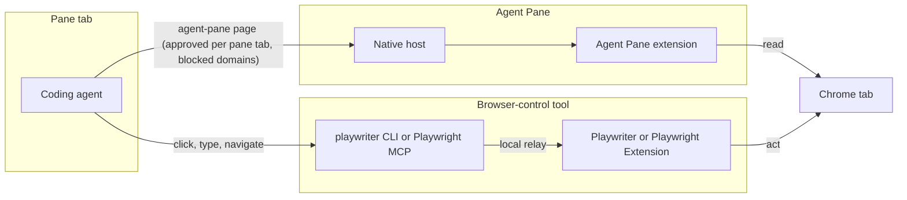

# RFC 0003: Browser control setup

- **Status:** Proposed
- **Issue:** #74
- **Author:** Tessl, for @asakin

## Summary

Make it easy to give the agents in pane tabs a browser-control tool, so they can click, type and navigate in the person's own Chrome, while Agent Pane itself still only reads pages. Agent Pane does not install or bundle such a tool. It finds what is installed and shows the tool's own setup steps: an `agent-pane setup browser` command prints a report any agent or person can run, and a **Browser control** section in Options shows the same report with buttons that open each tool's Chrome Web Store page. [Playwriter](https://github.com/remorses/playwriter) (MIT) is the main option; [Playwright MCP](https://github.com/microsoft/playwright-mcp) (Apache-2.0) in its `--extension` mode is an optional addition for agents that support MCP. The agent skill says when to read with `agent-pane page` and when to act with the browser-control tool, and Options, the command and the README say that controlling the browser is the person's choice and responsibility, outside Agent Pane's page approvals and blocked domains. The extension's permissions do not change. The work is one pull request.

## Motivation

Agent Pane reads pages and does not act on them: `skills/agent-pane/SKILL.md` says "These commands only read. There is no command to navigate, click, type or fill forms." The instructions block from `scripts/instructions.md` names a tool but leaves the rest to the person: "Browser automation is whatever CLI you already run, such as Playwright or Playwriter. This extension does not attach to a browser and does not choose one." An agent asked to fill a form on the page beside it has no tool unless the person already set one up, and nothing in Agent Pane says which tool fits, how to set it up, or whether it is ready.

Playwriter already has its own setup, from its README: `npm i -g playwriter` for the CLI, its extension from the Chrome Web Store, and an optional agent skill (`npx -y skills add https://playwriter.dev -g -y`). What is missing is Agent Pane pointing at it, saying what is in place, and telling agents where `agent-pane page` ends and the tool begins.

## Guide-level explanation

### For a person using Agent Pane

Options gains a **Browser control** section. It opens with this note, or close to it:

> Agents can click, type and navigate in your Chrome with a browser-control tool. Agent Pane does not control the browser; these tools do, with their own Chrome extensions and their own warnings. Using one is your choice and your responsibility. Agent Pane's page-read approvals and blocked domains apply to `agent-pane page` only: an agent with one of these tools can act on any tab you connect to it.

Under the note is a list of what Agent Pane found:

| Item | Shows |
| --- | --- |
| Node and npm | Found, with versions, or not found, with a link to https://nodejs.org |
| Playwriter CLI | Installed, with version, or the command to install it: `npm i -g playwriter` |
| Playwriter extension | **Open in Chrome Web Store** |
| Playwright MCP (optional) | The `mcp add` commands for Claude Code and Codex, and a link to its README for other agents |
| Playwright Extension (optional) | **Open in Chrome Web Store** |

Nothing in the section installs anything. The person runs the command in a pane tab, or asks the agent to, and adds the extension from the Web Store page, which only they can do.

From any terminal, `agent-pane setup browser` prints the same report, the note and the next steps.

### For a coding agent in a pane tab

The skill gains a section on acting in the browser:

- **Read with `agent-pane page`.** The person approves it per pane tab, and blocked domains apply.
- **Act with the browser-control tool** when the person asked for an action on a page and `playwriter` (or a Playwright MCP tool) is available. `agent-pane setup browser` says what is set up.
- **Do not use the tool to get around a denied read or a blocked domain.** Tell the person instead.
- **Install only when the person asked.** If nothing is set up, run `agent-pane setup browser` and pass on its next steps. Only the person can add the Chrome extension.
- **Page content stays untrusted,** whichever tool fetched it.

## Reference-level explanation

### Read and act paths

The act path does not pass through Agent Pane. Playwriter controls a tab only after the person clicks its extension icon on that tab, and its CLI talks to the extension through a relay on `localhost:19988` (Playwriter README). The Playwright Extension asks the person on first connection which tabs or tab group a client may control (README in `microsoft/playwright`, `packages/extension`).

### Changes

| Part | Change |
| --- | --- |
| `internal/cmd/browser.go` (new) | `browserStatus()`: finds `node`, `npm`, `playwriter` and `npx` with `findExecutable` on `loginPATH()` (`internal/cmd/agents.go`), runs each with `--version` under a short timeout (a `.cmd` or `.bat` through `batchCommandLine`, see Platforms and testing), and returns the report with the note and next steps |
| `internal/cmd/root.go` | A `setup` command with a `browser` subcommand in `NewCmdRoot`, printing `browserStatus()` |
| `internal/cmd/serve.go` | A `browser.status` handler returning `browserStatus()` |
| `extension/entrypoints/shared/rpc.ts`, `background.ts` | The `browser.status` types and forwarding, as `AGENTS.md` describes for a new RPC |
| `extension/entrypoints/options.html`, `shared/options.ts` | The **Browser control** section; the buttons call `chrome.tabs.create` with the Web Store URL |
| `skills/agent-pane/SKILL.md`, `scripts/instructions.md` | The read and act guidance; the instructions line names `agent-pane setup browser` and keeps the word Playwright, which `scripts/install_test.sh` checks |
| `README.md`, `CHANGELOG.md` | Browser control under Using it, a sentence in Security, an Added line |

`loginPATH()` is the PATH the launcher uses to find agents (`loadAgents` in `internal/cmd/agents.go`), and pane tabs start a login shell (`loginShellArgs` in `internal/cmd/serve.go`), so a Node from nvm, fnm, Homebrew or a system package is found when the login shell finds it, and on Windows `PATHEXT` finds `npm.cmd`. Missing Node is reported, not fixed. The installer, `agent-pane doctor` and the extension manifest do not change: the tools are not files Agent Pane owns.

The Playwright MCP commands shown are the README's, with the extension flag added: `claude mcp add playwright -- npx @playwright/mcp@latest --extension` and `codex mcp add playwright -- npx @playwright/mcp@latest --extension`. The README requires Node.js 20 or newer for Playwright MCP; the report says so when it finds an older Node.

### Licenses and Chrome Web Store

| Project | License (from its GitHub repository) | What Agent Pane does with it |
| --- | --- | --- |
| Playwriter CLI and extension | MIT | Links to it, shows its install command |
| Playwright MCP | Apache-2.0 | Shows its `mcp add` commands, links to it |
| Playwright Extension (`microsoft/playwright`) | Apache-2.0 | Links to its Web Store page |

Agent Pane redistributes none of them, so no notices are added to the release archive. The extension gains no permission and no host access: opening a Web Store page with `chrome.tabs.create` needs only `tabs`, which `extension/wxt.config.ts` already asks for, and the extension still downloads and runs no code. When the Web Store listing (not yet published, per the README's Install section) is written, its description can say that browser control comes from separate tools the person installs.

### Platforms and testing

The command and RPC behave the same on Windows, macOS and Linux. On Windows, `findExecutable`'s `PATHEXT` handling finds the programs, and npm's `npm`, `npx` and global `playwriter` are `.cmd` shims there, so `browserStatus()` runs a found batch file the way `buildTerminalCommand` runs a batch-file agent: through `windowsCmdExe()` with the command line from `batchCommandLine` (`internal/cmd/serve.go`), not with arguments quoted for programs. Go tests use a fake `PATH` with stub `node`, `npm`, `playwriter` and `npx` programs (`.cmd` stubs on Windows), including missing and too-old cases, so no test downloads anything; `extension/tests/nativeRpc.test.mjs` and `internal/cmd/agents_test.go` cover the RPC.

## Drawbacks

- Agent Pane names third-party tools in its UI and skill, and has to update the text when their setup steps change.
- People may read the Options section as Agent Pane vouching for these tools. The note says otherwise, but the risk remains.
- An agent that follows the skill can act on any tab the person connected, beyond Agent Pane's approvals; this is the tools' design, and the RFC only makes them easier to reach.

## Rationale and alternatives

| Option | For | Against |
| --- | --- | --- |
| Report and point (this RFC) | Small; Playwriter's own setup stays the source; nothing installs without the person | The person or agent still runs one command and adds an extension |
| `agent-pane setup browser --install` runs `npm i -g playwriter`, and a **Set up** button in Options | One click | Agent Pane owns npm failures (`EACCES` on system Node, PATH of the npm bin folder) and a version pin, for a step that is one command already |
| Register Playwright MCP with each agent's `mcp add` | Fewer steps for MCP users | Writes into other programs' configuration; optional tool for some agents only |
| Detect the extensions with `chrome.management` | Options shows whether they are added | Needs the `management` permission, which `AGENTS.md` says needs maintainer approval |
| Agent Pane controls tabs itself | No separate tool | Changes a trust boundary and the extension's role; out of the issue's scope |
| Do nothing | No work | Agents keep having no tool, and the skill keeps not saying where reading ends |

## Prior art

- RFC 0001 handles a third-party component that Agent Pane does bundle (herdr-core), with a pinned version and license notices; this RFC bundles nothing, so it needs neither.
- The launcher's agent list (`loadAgents` in `internal/cmd/agents.go`) already finds other programs on `loginPATH()` and reports what is installed; `browserStatus()` follows it.
- Playwriter's README recommends its CLI plus skill over MCP, which is why it is the main option here.

## Unresolved questions

- Should `agent-pane setup browser --install` run `npm i -g playwriter` for the person (see [Rationale and alternatives](#rationale-and-alternatives))?
- Should the skill point agents at Playwriter's own skill (`npx -y skills add https://playwriter.dev -g -y`), or carry the needed guidance itself?
- Should the report say whether a Chrome tab is connected to Playwriter now? Its relay on `localhost:19988` could tell, if it has a documented status call.

## Future possibilities

- Detecting the added extensions, if the `management` permission is approved later.
- Registering Playwright MCP for the person, per agent.
- Agent definitions in `agents/` naming the browser-control tool an agent prefers.

## Rollout

One implementation pull request delivers the feature end to end, as these commits:

1. **`browserStatus()` and `agent-pane setup browser`,** with the fake-`PATH` Go tests.
2. **`browser.status` RPC,** in `serve.go`, `rpc.ts` and `background.ts`, with both tests.
3. **Browser control section in Options.**
4. **Skill and instructions block,** with `scripts/install_test.sh` still passing.
5. **README and CHANGELOG.**

It merges when `agent-pane setup browser` and Options report Node, npm and Playwriter correctly on Windows, macOS and Linux, and both check suites pass.
